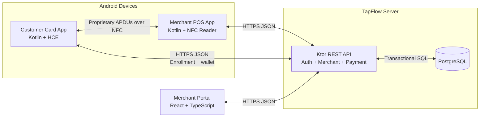
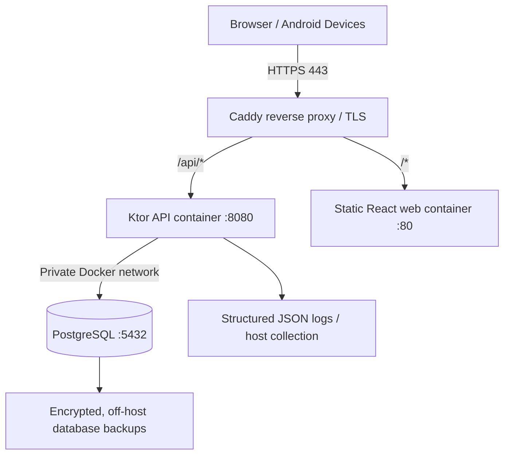
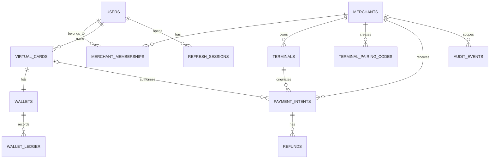
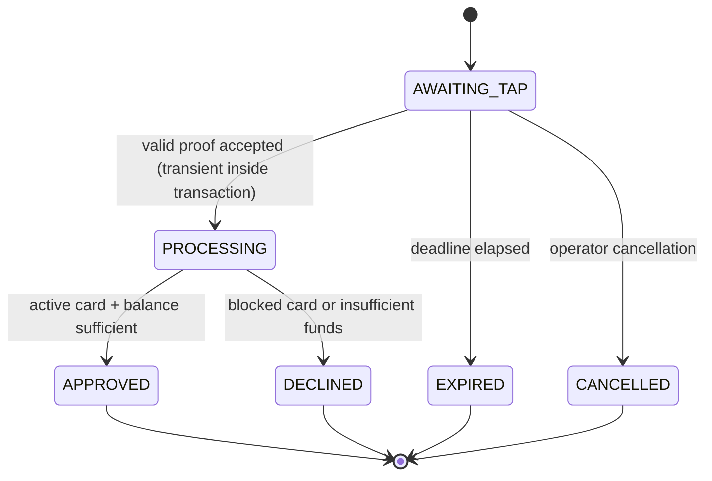
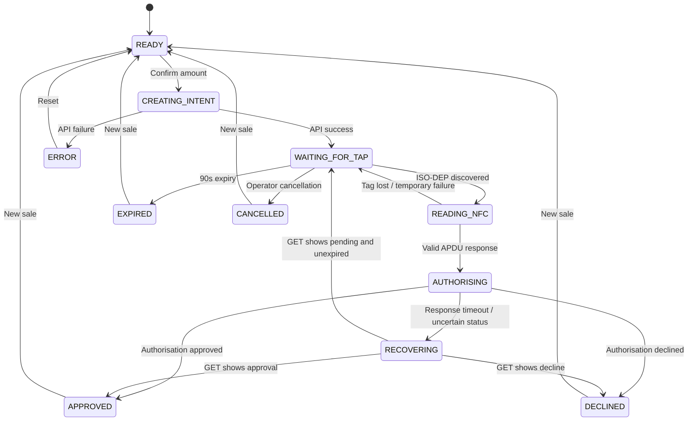
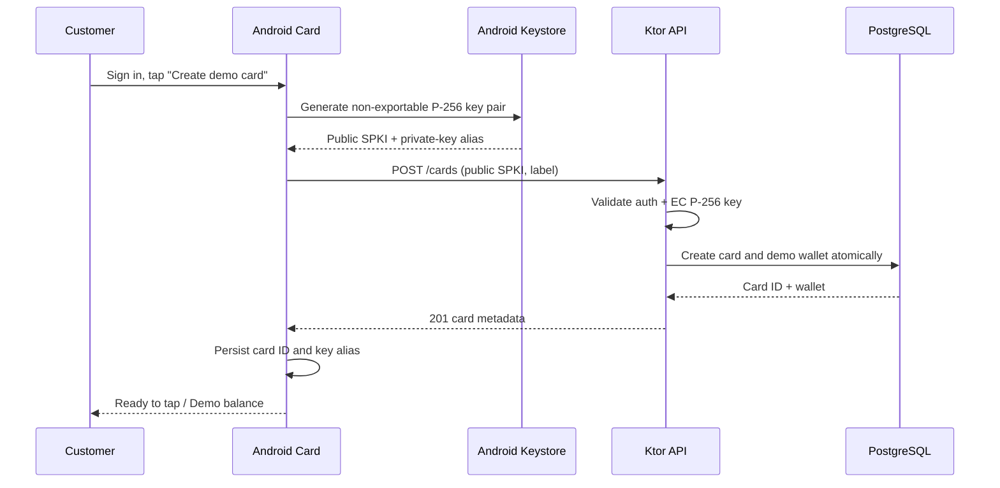
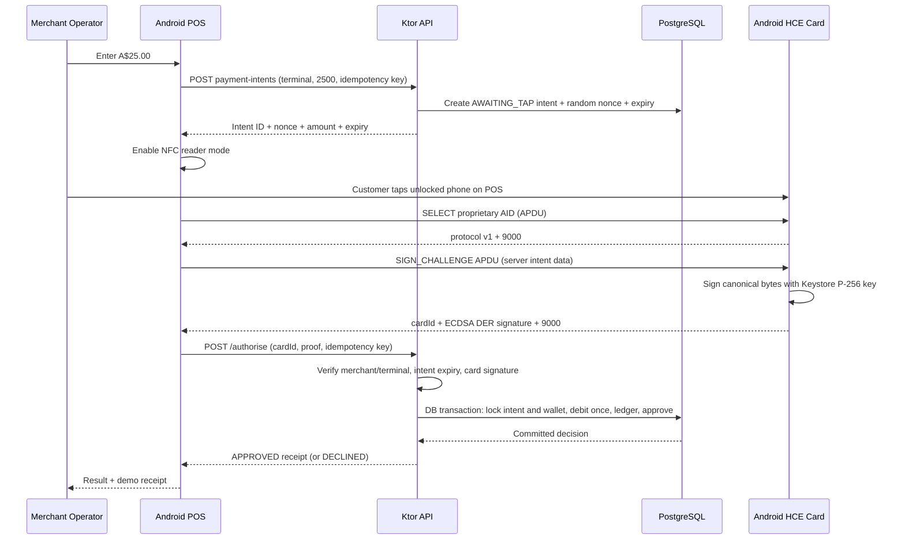
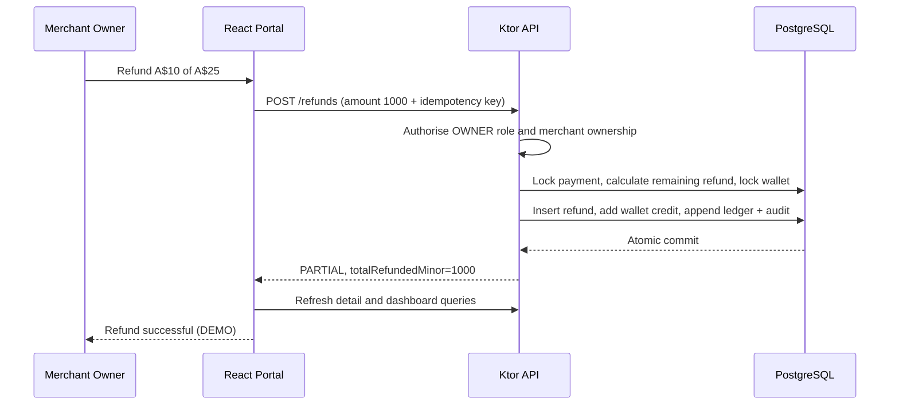

# TapFlow — Complete System Specification (`overall.md`)

> **Status:** Implementation-ready architecture and coding-agent contract  
> **Product:** TapFlow, a **closed-loop NFC payment simulator** and merchant operations portal  
> **Primary audience:** Autonomous coding agents, developers, reviewers, and interviewers  
> **Platform:** Android (Kotlin), backend (Kotlin/Ktor), web (React/TypeScript), PostgreSQL, Docker  
> **Deployment target:** Single Linux VPS for a portfolio demo, with a path to managed production-like hosting  
> **Currency:** Australian dollars (`AUD`) only in v1  
> **Document version:** 1.0 — 2026-11-07

---

## 0. Read this first — instructions to the coding agent

You are implementing a **complete, runnable monorepo**, not a mockup. Follow this document as the source of truth. Implement real frontend-to-backend integration, Android-to-backend integration, Android-to-Android NFC communication, persistent PostgreSQL storage, automated tests, and reproducible deployment. Do not substitute static JSON or fake frontend screens for working APIs.

**Non-negotiable limits:**

1. This is an **educational simulation**. It must **never claim to process real bank-card payments**, be EMV-certified, or satisfy PCI MPoC. It does not read bank-card PANs, CVVs, PINs, or real payment credentials.
2. Only communicate with our **custom TapFlow HCE test card** and proprietary AID. Do not probe real bank cards or claim to implement a production EMV kernel.
3. Money is **simulated stored value**, not actual AUD transferred through banks. Every screen, API documentation page, and receipt must carry a visible `DEMO / NO REAL MONEY` indicator.
4. Use two Android apps: one for the simulated customer card and one for the merchant terminal. Use Kotlin for both apps and for the backend.
5. Apply tenant/merchant access controls **inside backend queries and services**, not just in the web UI. All transactions must be idempotent and concurrency-safe.
6. Do not commit production secrets, private signing keys, `.env` files, real credentials, or database dumps.
7. Write tests alongside features. Do not call a feature complete if its tests or acceptance criteria fail.
8. If an implementation detail conflicts with an external library version, choose the current stable compatible version, **pin it**, update this spec/ADR, and preserve the behavioural contracts defined here.
9. Implement in the dependency order given in **§20**. The agent may make reasonable local implementation decisions without pausing for approval; document material deviations under `docs/adr/`.
10. At completion, provide a working `README.md`, `docs/setup.md`, `docs/demo-script.md`, OpenAPI spec, architecture diagram, test commands, deployment instructions, and screenshots/GIFs of the actual running product.

### 0.1 What “complete” means

The system passes an end-to-end demonstration:

- An owner signs in to the web portal and creates an expiring POS pairing code.
- A merchant operator logs into the Android POS and pairs a physical NFC Android phone to that merchant.
- A customer logs into a second NFC-capable Android phone, generates a **device-held test key**, and enrolls a virtual card with demo funds.
- The operator enters **A$25.00** on the terminal. The backend creates a single-use, short-lived payment intent and challenge.
- The customer unlocks their phone and taps it against the POS. The POS selects the TapFlow AID and exchanges APDUs with the HCE app.
- The HCE app signs a canonical challenge using its device-held private key; the POS sends the signature and card ID to the API.
- The API verifies the signature and challenge, atomically debits the **demo wallet**, saves an approval, and returns a receipt.
- The web portal lists the payment; an owner issues a partial refund; both the wallet and payment details update correctly.
- Replays, insufficient funds, expired intents, invalid signatures, repeat requests, offline errors, and cross-merchant access are handled correctly.
- The same backend and web build launch via Docker Compose on a clean Linux server with HTTPS.

---

## 1. Product definition and boundaries

### 1.1 Problem

Demonstrate the engineering of an end-to-end contactless transaction experience: NFC interoperability, secure challenge/response, resilient payment orchestration, role-based merchant portals, financial state consistency, observability, and deployment. The portfolio emphasis is on the **backend and web systems integrating with custom payment hardware**, with Kotlin/NFC as the differentiator.

### 1.2 Users and permissions

| Persona | Description | Capabilities |
| --- | --- | --- |
| `CUSTOMER` | Owner of a simulated card and wallet | Sign in on Card app, enroll/disable own test card, view own balance and activity |
| `MERCHANT_OPERATOR` | Merchant staff using POS | Pair a terminal with an authorised pairing code, create/authorise/cancel payments, view merchant payments |
| `MERCHANT_OWNER` | Merchant administrator | All operator functions; manage terminal pairing/disable terminals; view dashboard; issue refunds; view audit log |
| `SYSTEM_ADMIN` | Maintenance-only account | Seed and maintain demo merchants and test accounts; **not** exposed as general public signup |

An account may be assigned to multiple merchants. Every merchant-scoped API accepts a `merchantId` path parameter and verifies membership/role; do **not** trust merchant IDs from the client without checking them.

### 1.3 In scope (v1)

- Android HCE test card and reader with a custom APDU protocol.
- Demo wallet and server-side mock authorisation decisions.
- Merchant onboarding via scripted seed, paired terminals, merchant/user roles.
- Payment intent lifecycle, replay defence, idempotency, partial/full refunds, ledger.
- React web portal: login, overview, transactions, details, refunds, terminals, audit/events.
- PostgreSQL persistence, SQL migrations, REST/OpenAPI, Docker Compose dev/prod, HTTPS, CI, tests.
- Error states, accessibility, loading states, structured logs, backups, health endpoints.

### 1.4 Explicitly out of scope

- Real Mastercard/Visa/eftpos acceptance; EMV Level 1/Level 2 kernels; issuer network connectivity.
- Acquisition, settlement to banks, real bank accounts, real PAN/tokenised PAN, PCI certification.
- PIN entry, cardholder data environments, payment network AIDs, production SoftPOS claims.
- Real donation transfers, KYC/AML, dispute/chargeback workflows, multi-currency FX.
- Kubernetes, Kafka, microservices, AI scoring, and hardware reader peripherals for v1.

### 1.5 Non-functional requirements

| Dimension | Target |
| --- | --- |
| API correctness | No double debit/refund from retries or concurrent requests |
| NFC | Minimal APDU round trips; support normal tap/retap and `TagLostException` |
| Web | Responsive down to 360px, keyboard navigable, labels and status announcements |
| API latency | Local/healthy p95 under 300 ms for ordinary CRUD; no strict guarantee across mobile networks |
| Data integrity | Database constraints + transactional ledger writes; no floating point currency |
| Security | TLS externally; JWT validation; strong password hashing; hashed refresh tokens; rate limiting |
| Observability | Correlation ID, structured logs, health/readiness, audit records, no secret leakage |
| Operations | Reproducible local dev and VPS deployment; backups with tested restoration |
| Documentation | Clear quickstart and 3–5 minute recorded demo route |

---

## 2. Technology choices

| Component | Stack | Notes |
| --- | --- | --- |
| Android Card | Kotlin, Jetpack Compose, Android `HostApduService`, Android Keystore, Retrofit or Ktor Client | `android:category="other"`; device-unlock required |
| Android POS | Kotlin, Jetpack Compose, `NfcAdapter` reader mode, `IsoDep`, Retrofit or Ktor Client | Run blocking `transceive()` on `Dispatchers.IO` |
| Shared NFC library | Pure Kotlin/JVM Gradle module | APDU codec, canonical byte encoding, status words, fixtures |
| Backend | Kotlin/JVM 21, **Ktor 3.x**, Netty, kotlinx.serialization | Modular monolith; thin routes; services + repositories |
| Database | PostgreSQL 17+, Flyway SQL migrations, Exposed SQL DSL or plain parameterised SQL, HikariCP | Flyway is the only migration owner |
| Web | React, TypeScript (`strict`), Vite, React Router, TanStack Query, Tailwind CSS, Zod | Generated API types from OpenAPI; no hard-coded responses |
| API contract | OpenAPI 3.1 YAML under `contracts/` | Source of truth for REST schema |
| Auth | JWT access tokens, rotating opaque refresh tokens, Argon2id password hashes | Web refresh cookie; mobile Keystore-backed encrypted local storage |
| Local runtime | Docker Compose, PostgreSQL, API, web | Android runs on physical devices/emulator |
| Deployment | Docker multi-stage, Caddy TLS reverse proxy, Nginx or Caddy static web, VPS | No public PostgreSQL port |
| Tests | Kotlin/JUnit5, Kotest optional, MockK, Testcontainers, Vitest/RTL, Playwright, Android instrumented tests | Focus on state-machine and concurrency |
| CI | GitHub Actions | Quality gates, builds, security scans, Compose smoke test |

**Dependency policy:** Do not use floating versions (`+`, `latest`) for app dependencies or container images. Pin known-compatible stable versions at implementation time, ideally via a Gradle version catalog and `pnpm-lock.yaml`. Commit lockfiles. Java 21 is the baseline. Target the latest stable Android SDK supported by the project tooling at implementation time; use `minSdk=28` unless a tested dependency requires otherwise. Ktor 3.x is supported by the current official documentation; follow the stable supported minor release when coding.

---

## 3. High-level architecture



### 3.1 Key architectural rules

- **Single deployable API**, internally separated by domain packages (`auth`, `cards`, `merchants`, `terminals`, `payments`, `refunds`, `ledger`, `audit`). Do not introduce multiple networked microservices.
- **The backend is authoritative** for intent parameters, merchant membership, challenge expiration, authorisation state, wallet balances, and refunds.
- **The HCE private key stays on the customer device**. Only the public key is registered on the server.
- **The POS is untrusted input**. The server reconstructs signed bytes from its own stored intent and verifies the registered public key.
- Web and mobile clients share one JSON API but have appropriately different refresh-token mechanisms.
- Monetary amounts use **signed 64-bit integer minor units (cents)** in APIs/DB; validate positive amounts and upper bounds before arithmetic. Never use JS floating point for authoritative monetary calculations.
- Use **UTC** timestamps (RFC 3339 on API, `timestamptz` in PostgreSQL). Display dates in the user's locale/Australia-Melbourne on web.
- Maintain a non-editable audit trail for critical security and money-state operations.

### 3.2 Deployment topology



In local development, Vite serves the web and proxies `/api` to the backend; on VPS, **one same-origin hostname** serves frontend and API, simplifying authentication and CORS.

---

## 4. Monorepo directory structure (required)

```text
tapflow/
├── overall.md                            # This specification
├── README.md                             # One-page quickstart + feature showcase
├── .gitignore
├── .editorconfig
├── .env.example                         # Placeholders ONLY
├── .github/
│   └── workflows/
│       ├── ci.yml                       # JVM, web, and Compose tests
│       ├── android.yml                  # Android builds + unit tests
│       └── deploy.yml                   # Manual/protected production deployment
├── gradle/
│   └── libs.versions.toml               # Pin Kotlin, Android, Ktor, testing versions
├── gradlew
├── gradlew.bat
├── settings.gradle.kts                  # Include backend, shared protocol, two Android apps
├── build.gradle.kts
├── gradle.properties
├── apps/
│   ├── android-card/
│   │   ├── build.gradle.kts
│   │   └── src/
│   │       ├── main/
│   │       │   ├── AndroidManifest.xml
│   │       │   ├── res/xml/apduservice.xml
│   │       │   └── java/com/tapflow/card/
│   │       │       ├── MainActivity.kt
│   │       │       ├── hce/TapFlowHostApduService.kt
│   │       │       ├── crypto/CardKeyManager.kt
│   │       │       ├── data/CardRepository.kt
│   │       │       ├── data/AuthRepository.kt
│   │       │       ├── ui/{login,enroll,wallet,activity,settings}/
│   │       │       └── di/AppModule.kt
│   │       ├── test/
│   │       └── androidTest/
│   ├── android-pos/
│   │   ├── build.gradle.kts
│   │   └── src/
│   │       ├── main/java/com/tapflow/pos/
│   │       │   ├── MainActivity.kt
│   │       │   ├── nfc/NfcReaderController.kt
│   │       │   ├── nfc/IsoDepTransport.kt
│   │       │   ├── data/{AuthRepository,TerminalRepository,PaymentRepository}.kt
│   │       │   ├── ui/{login,pair,checkout,result,history,settings}/
│   │       │   ├── state/CheckoutViewModel.kt
│   │       │   └── di/AppModule.kt
│   │       ├── test/
│   │       └── androidTest/
│   └── web/
│       ├── package.json
│       ├── pnpm-lock.yaml
│       ├── vite.config.ts
│       ├── tsconfig.json
│       ├── index.html
│       ├── Dockerfile
│       ├── nginx.conf
│       ├── public/
│       ├── src/
│       │   ├── main.tsx
│       │   ├── app/{router,providers,auth}/
│       │   ├── api/{client,generated,queries,mutations}/
│       │   ├── components/{ui,layout,feedback}/
│       │   ├── features/{auth,dashboard,payments,refunds,terminals,audit}/
│       │   ├── pages/
│       │   ├── hooks/
│       │   ├── lib/{currency,dates,errors}/
│       │   └── styles/
│       ├── tests/
│       └── e2e/
├── packages/
│   └── protocol-kotlin/
│       ├── build.gradle.kts
│       └── src/{main,test}/kotlin/com/tapflow/protocol/
│           ├── ProtocolConstants.kt
│           ├── ApduCodec.kt
│           ├── ChallengeCodec.kt
│           ├── SignatureVerifier.kt
│           └── ProtocolFixtures.kt
├── services/
│   └── payment-api/
│       ├── build.gradle.kts
│       ├── Dockerfile
│       └── src/
│           ├── main/
│           │   ├── kotlin/com/tapflow/api/
│           │   │   ├── Application.kt
│           │   │   ├── config/{AppConfig,Plugins,Security}.kt
│           │   │   ├── common/{ApiError,RequestContext,Idempotency}.kt
│           │   │   ├── auth/{AuthRoutes,AuthService,TokenService}.kt
│           │   │   ├── cards/{CardRoutes,CardService,CardRepository}.kt
│           │   │   ├── merchants/{MerchantRoutes,MerchantAccess}.kt
│           │   │   ├── terminals/{TerminalRoutes,TerminalService}.kt
│           │   │   ├── payments/{PaymentRoutes,PaymentService,PaymentRepository}.kt
│           │   │   ├── refunds/{RefundRoutes,RefundService}.kt
│           │   │   ├── ledger/{WalletRepository,LedgerService}.kt
│           │   │   ├── audit/{AuditService,AuditRoutes}.kt
│           │   │   └── db/{DatabaseFactory,MigrationRunner}.kt
│           │   └── resources/
│           │       ├── application.conf
│           │       └── db/migration/
│           │           ├── V001__initial_schema.sql
│           │           ├── V002__indexes.sql
│           │           └── V003__seed_support.sql  # Only if needed, no secrets
│           └── test/kotlin/com/tapflow/api/
├── contracts/
│   ├── openapi.yaml                     # Versioned REST contract
│   ├── example-requests.http
│   └── fixtures/{apdu-v1.json,payments.json}
├── infra/
│   ├── compose/{dev.yml,prod.yml}
│   ├── caddy/Caddyfile
│   ├── scripts/{seed-demo.sh,smoke-test.sh,backup-db.sh,restore-db.sh,deploy.sh}
│   └── monitoring/README.md
└── docs/
    ├── setup.md
    ├── architecture.md
    ├── api.md
    ├── nfc-protocol.md
    ├── security.md
    ├── operations.md
    ├── demo-script.md
    ├── troubleshooting.md
    ├── adr/
    └── screenshots/
```

Use the folder names above unless a framework imposes a small variation. The source tree must match the modules declared in the Gradle settings and scripts.

---

## 5. Domain model and database schema

### 5.1 Relationships



### 5.2 Required tables (Flyway SQL, PostgreSQL)

**Use UUID primary keys** generated server-side, `timestamptz` for times, `bigint` for minor amounts, `bytea` for nonce and signature hashes, and explicit `CHECK`/`UNIQUE`/FK constraints. Implement the following as real migrations.

| Table | Required columns | Constraints and purpose |
| --- | --- | --- |
| `users` | `id`, `email`, `password_hash`, `account_type`, `active`, `created_at`, `updated_at` | Unique lowercased email; Argon2id; types `CUSTOMER`, `MERCHANT`, `SYSTEM_ADMIN` |
| `merchants` | `id`, `name`, `slug`, `status`, `created_at` | Unique slug; status `ACTIVE`/`SUSPENDED` |
| `merchant_memberships` | `user_id`, `merchant_id`, `role`, `created_at` | PK `(user_id, merchant_id)`; role `OWNER` or `OPERATOR` |
| `terminals` | `id`, `merchant_id`, `label`, `installation_id`, `status`, `paired_by_user_id`, `paired_at`, `last_seen_at` | Unique `installation_id`; active/disabled; scoped to merchant |
| `terminal_pairing_codes` | `id`, `merchant_id`, `code_hash`, `expires_at`, `consumed_at`, `created_by`, `created_at` | Hash code; single use; 10-minute expiry; rate limit attempts |
| `virtual_cards` | `id`, `owner_user_id`, `label`, `public_key_spki`, `key_algorithm`, `status`, `created_at` | SPKI DER public key only; unique card ID; `P256_SHA256_ECDSA`; active/blocked |
| `wallets` | `id`, `card_id`, `currency`, `balance_minor`, `created_at`, `updated_at` | Unique card; AUD; balance >= 0; demo value only |
| `payment_intents` | `id`, `merchant_id`, `terminal_id`, `card_id` nullable, `amount_minor`, `currency`, `challenge_nonce`, `expires_at`, `status`, `decision_code` nullable, `proof_sha256` nullable, `receipt_number` nullable, `order_reference` nullable, `created_at`, `updated_at`, `authorised_at` nullable | Valid amount `1..1_000_000` minor units (demo cap A$10,000); 16-byte nonce; unique non-null receipt number; use state machine below |
| `refunds` | `id`, `payment_intent_id`, `merchant_id`, `amount_minor`, `reason`, `created_by`, `created_at` | Positive; total per payment <= approved amount; unique idempotency key context |
| `wallet_ledger` | `id`, `wallet_id`, `payment_intent_id` nullable, `refund_id` nullable, `entry_type`, `amount_minor`, `balance_after_minor`, `created_at` | Immutable append-only; one debit per approved intent; one credit per refund |
| `idempotency_records` | `id`, `scope`, `idempotency_key`, `request_sha256`, `response_status`, `response_json`, `created_at`, `expires_at` | Unique `(scope, idempotency_key)`; reject same key/different body; TTL cleanup |
| `refresh_sessions` | `id`, `user_id`, `token_hash`, `family_id`, `client_type`, `expires_at`, `revoked_at`, `created_at`, `rotated_from_id` | Opaque 256-bit random tokens; store hash only; enforce rotation/reuse policy |
| `audit_events` | `id`, `actor_user_id` nullable, `merchant_id` nullable, `event_type`, `resource_type`, `resource_id` nullable, `details_json`, `request_id`, `created_at` | Append-only; do not store passwords, JWTs, secrets, raw APDUs, sensitive request bodies |

**Additional recommended database rules:**

- `payment_intents` indexes: `(merchant_id, created_at DESC, id DESC)`, `(terminal_id, created_at DESC)`, `(status, expires_at)`.
- `refunds` index on `(payment_intent_id, created_at)`.
- `wallet_ledger` unique partial indexes: one `DEBIT` per `payment_intent_id`, and one `CREDIT` per `refund_id`.
- `idempotency_records` index on `expires_at`; never silently reuse an unexpired key for a different request body.
- Add `created_at`/`updated_at` triggers or set consistently from the server; timestamps must be UTC.
- Use numeric amounts in API response as integer **minor units**, never locale-formatted strings.
- `public_key_spki` must be at most a sensible encoded key size (e.g. <= 1024 bytes), with server-side validation that the parsed key is a valid P-256 EC key.

### 5.3 Payment status state machine



`PROCESSING` is an **internal transient state** and must not be durably stuck after a crash. The easiest implementation is to keep the intent `AWAITING_TAP` until a single DB transaction commits a terminal `APPROVED` or `DECLINED` decision; expose `PROCESSING` only as a terminal UI state if desired.

**Refund state is derived**, not a mutation of the payment authorisation status:

- `approvedAmountMinor` is the original authorised amount.
- `refundedAmountMinor = SUM(refunds.amount_minor)`.
- `refundStatus = NONE | PARTIAL | FULL` based on that sum.
- A successful refund appends a wallet credit and refund record in one transaction.
- A decline/expired/cancelled payment may not be refunded.

### 5.4 Authoritative authorisation rules

1. A wallet/card must exist, be active, and use `AUD`.
2. Intent must be `AWAITING_TAP`, unexpired, and belong to the authenticated merchant and paired terminal.
3. The submitted card signature must verify against the server-reconstructed canonical challenge and registered public key.
4. The intent is **single-use**. A different proof after a terminal decision is a conflict, not a second debit.
5. Lock the intent row (`SELECT ... FOR UPDATE`). For wallet movements also lock the wallet row. Follow the same lock ordering in all payment/refund operations.
6. If the wallet balance is insufficient: set `DECLINED` with `INSUFFICIENT_FUNDS`; no debit ledger row.
7. If sufficient: decrement wallet balance and insert ledger `DEBIT` exactly once; set intent `APPROVED` in the same database transaction.
8. Invalid signature, bad request, tenant violation, or expired intent **must not debit**; report stable machine-readable error codes.
9. Recover from a client/network timeout by querying the intent's authoritative status. **Never retry by silently creating another payment intent.**
10. Use a deterministic demo decline reason: `CARD_BLOCKED`, `INSUFFICIENT_FUNDS`; optional internal test scenarios may be added behind admin-only flags.

### 5.5 Idempotency policy

- Header: `Idempotency-Key: <UUID v4>` for **create payment**, **authorise**, **refund**, and **terminal pairing-code creation**.
- Scope keys by `{authenticated user or terminal identity}:{HTTP route}:{merchantId}`; store a hash of the **canonical parsed request** (or a stable canonical serialisation), not raw whitespace-sensitive JSON.
- On exact retry, return the **same persisted HTTP status and response body**. On same key with different payload, return `409 IDEMPOTENCY_KEY_REUSED`.
- Database uniqueness must arbitrate concurrent first-writer claims; do not rely on an application-level in-memory lock.
- Avoid committing an idempotency response separately from its payment/ledger transaction. Use one DB transaction for outcome + idempotency result. A transaction that rolls back does not consume a successful idempotency claim.
- Retain idempotency records for **at least 24 hours** and clean them on a bounded schedule. `Idempotency-Key` retries after expiry are not a substitute for a unique one-time intent ID.

---
## 6. NFC protocol — TapFlow APDU v1

This protocol is **proprietary** and deliberately **not EMV**. Its purpose is to teach ISO-DEP/APDU framing, HCE, application selection, challenge-response, and backend verification.

### 6.1 Hardware requirements

- **Card phone:** Android device reporting `FEATURE_NFC` and `FEATURE_NFC_HOST_CARD_EMULATION`.
- **POS phone:** Android device with NFC reader support; implement reader mode on a foreground Activity.
- **Two physical devices** are needed for the full NFC demo. An Android emulator is useful for UI/tests but cannot be assumed to reproduce physical device-to-device NFC.
- Enable NFC on both phones; keep card phone **unlocked**, and test OS-specific wallet/AID routing behaviour.

### 6.2 Proprietary Application ID

- TapFlow development AID: `F0544150464C4F5731` (hex; 9 bytes: `F0` + ASCII `TAPFLOW1`).
- HCE AID group category: `other` (NOT `payment`).
- Treat this AID as development-only; formally register a non-colliding AID if this protocol is ever deployed beyond the controlled demo.
- Android HCE manifest: service exported with `android.permission.BIND_NFC_SERVICE`, and `android.nfc.cardemulation.host_apdu_service` metadata pointing at `res/xml/apduservice.xml`.
- `apduservice.xml`: `android:requireDeviceUnlock="true"`, `android:category="other"`, AID filter as above.

### 6.3 APDU exchange

**Command A — SELECT application**

```text
CLA INS P1 P2 Lc  AID bytes (9)                   Le
00  A4  04 00 09  F0 54 41 50 46 4C 4F 57 31     00
```

Expected successful response: `01 90 00` (`01` = TapFlow protocol version, `90 00` = success). Reject unexpected version or bad status word. The HCE service must check exact SELECT structure and AID.

**Command B — SIGN_CHALLENGE**

```text
CLA INS P1 P2 Lc   Payload (exactly 68 bytes)       Le
80  20  00 00 44   [challengeRequestBytes]         00
```

`challengeRequestBytes`, in this exact order:

| Bytes | Format | Field |
| --- | --- | --- |
| 1 | `0x01` | protocol version |
| 16 | UUID bytes in network order | `paymentIntentId` |
| 16 | UUID bytes in network order | `merchantId` |
| 8 | unsigned, big-endian | `amountMinor` |
| 3 | ASCII | `AUD` |
| 16 | cryptographically random bytes from server | `challengeNonce` |
| 8 | unsigned, big-endian | `expiresAtEpochMillis` |
| **68** | | **Total** |

Success response data, followed by ISO status `90 00`:

```text
protocolVersion:          1 byte = 01
cardId:                  16 bytes UUID, network byte order
signatureLength:         1 byte N (max 100)
signatureDer:             N bytes, ASN.1 DER-encoded ECDSA signature
statusWord:              2 bytes = 90 00
```

All APDU messages must be length-checked **before** decoding. Short or malformed APDUs must fail safely, never throw uncaught exceptions in the Android service.

| Status word | Meaning |
| --- | --- |
| `9000` | Success |
| `6A82` | Unknown AID / application not found |
| `6A80` | Incorrect/malformed data |
| `6985` | Card not enrolled, inactive locally, locked, or otherwise not ready |
| `6D00` | Unsupported instruction |
| `6F00` | Unexpected internal failure (do not leak exception details) |

### 6.4 Canonical bytes and signing — cross-platform contract

ECDSA scheme: **P-256 (`secp256r1`) with SHA-256**, Java algorithm `SHA256withECDSA`. Signature transmitted as standard DER sequence, **not** IEEE P1363 concatenated R/S. Public key registered as X.509/SPKI DER (base64 in JSON).

Canonical message to sign is **exactly**:

```text
ASCII("TAPFLOW-DEMO-V1")
|| 0x00
|| challengeRequestBytes  // exactly 68 bytes from §6.3
|| cardIdUuidBytes         // exactly 16 bytes, big-endian UUID order
```

No JSON, text delimiters, implicit charset, or locale formatting is allowed in this signature input. On HCE, parse the challenge bytes, look up the card ID, build canonical bytes, sign via Android Keystore. On API, fetch the stored intent and card; **rebuild the same bytes using the values in the database** and verify the submitted signature. Do **not** trust any amount, nonce, merchant ID, or expiration read back from the POS at authorisation time.

**Card key lifecycle:**

1. During enrollment generate non-exportable EC P-256 private key in `AndroidKeyStore` with signing permitted and SHA-256 digest; do not require biometric authentication for each NFC tap, because background HCE cannot reliably supply that interaction. Require the physical device to be unlocked through HCE configuration.
2. Export only the public SPKI encoding. Register `{label, publicKeySpkiBase64, algorithm}` with the authenticated customer API.
3. Persist assigned `cardId` and key alias in private application storage. The backend must validate curve/encoding and key uniqueness if supported.
4. Never upload the private key. On reinstall/key loss, disable the old card and enroll a new one; do not attempt key recovery by copying private bytes.
5. The HCE service must work while the card app is not open, with the enrolled card locally accessible; **no network request or DB call inside the NFC exchange**.

**Important limitation:** A passive tap is not equivalent to trusted on-screen approval of the exact amount. The customer app should clearly describe this as a demo tap. This workflow is unsuitable for real money without a validated user-consent and payment-security architecture.

### 6.5 NFC reader and HCE implementation details

**Card HCE:**

- Extend `HostApduService`, implement `processCommandApdu` and `onDeactivated`.
- Never perform expensive key operations or blocking IO on the main thread. For asynchronous crypto, return `null` then call `sendResponseApdu()` when ready, ignoring/cancelling late results after `onDeactivated`.
- SELECT clears per-session state; only process SIGN_CHALLENGE after successful SELECT.
- Limit input sizes and validate protocol version, amount > 0, currency == AUD, and syntactically valid expiry (backend is authoritative for whether expired).
- Maintain only short-lived in-memory tap/session information; clear it on deactivation.
- Show last tap/result to customer as a **best-effort local event**; HCE completion alone does not prove server authorisation.

**POS reader:**

- Use `NfcAdapter.enableReaderMode()` while the checkout screen is actively awaiting a tap; disable on screen exit or resolved payment. Handle NFC unavailable/disabled states.
- Use `NfcAdapter.FLAG_READER_NFC_A` (and NFC-B if device testing warrants) with `FLAG_READER_SKIP_NDEF_CHECK`.
- Resolve `IsoDep.get(tag)`, call `connect()` and `transceive()` on `Dispatchers.IO`, and `close()` in `finally`.
- Enforce reader state guard (`IDLE → CREATING_INTENT → WAITING_FOR_TAP → READING → AUTHORISING → SUCCESS/DECLINED/ERROR`). No parallel reads or duplicate POSTs.
- Show `HOLD PHONES TOGETHER`, `PROCESSING`, `TAP AGAIN`, `APPROVED`, and `DECLINED` UX states; handle `TagLostException`, timeouts, NFC disabled, unsupported tag, protocol version mismatch, and stale intent.
- On transient backend timeout after proof submission, **GET the existing intent** and show its actual status; never assume the transaction failed and automatically create a new intent.

### 6.6 Protocol tests and fixtures

Create `contracts/fixtures/apdu-v1.json` containing:

- Exact SELECT request and response hex from §6.3.
- A fixed intent UUID, merchant UUID, card UUID, amount `2500`, currency `AUD`, 16-byte nonce, and fixed millisecond expiry.
- The resulting challenge request hex and canonical message hex.
- An EC P-256 **test fixture public key** and a signature generated using a **clearly marked non-production test private key**, stored only under test fixtures (never used by installed demo card or a deployed server).
- Positive verification plus negative tests: changed amount, nonce, merchant, expiry, card ID, malformed DER signature, wrong key, repeated signed intent.

Verify identical challenge/canonical encoding in Android modules, shared library, and API tests. A signature fixture can be nondeterministic at generation time; pin the generated bytes in the committed test fixture and verify them repeatedly.

---

## 7. Backend specification (Kotlin / Ktor)

### 7.1 Domain architecture and dependency direction

```text
HTTP routes / request DTOs
        ↓
Service layer (authorisation, role checks, orchestration)
        ↓
Repositories and transaction boundary
        ↓
PostgreSQL

Shared protocol library ← NFC challenge/signature verification
```

Guidelines:

- Routes parse, validate, authenticate, and translate results into response DTOs. No SQL or cryptographic decision-making in routes.
- Services implement merchant isolation, state transitions, permissions, idempotency, business rules, and audit events.
- Repositories perform parameterised DB operations. Use DB transactions for all money-state changes.
- Configure Ktor `ContentNegotiation`, JSON, authentication, CORS (strict allowlist if cross-origin local dev is used), `StatusPages`, request IDs, rate limiting, and compression where appropriate.
- Keep failures typed (`DomainError`) and map to stable error codes. Do not return exception stack traces to clients.
- Use dependency injection via simple constructor composition/Koin if justified; prefer clear testability over an elaborate DI framework.
- Use Kotlin coroutines correctly: offload JDBC/blocking persistence to a bounded IO dispatcher; do not block Netty event loops.
- Clock and UUID/random sources must be injectable in tests.

### 7.2 Authentication and refresh sessions

**Access tokens:** short lived (15 minutes); JWT signed using a strong environment-provided key or asymmetric signing key, with issuer, audience, subject, expiration, unique token ID. Validate algorithm allowlist, issuer, audience, expiration, active user. Claims may include account type; merchant membership is checked against database for sensitive routes, not trusted solely from stale claims.

**Passwords:** Argon2id with current suitable parameters; login errors generic. Rate-limit by IP and account. Do not embed hard-coded credentials in code or public build output.

**Web:** `POST /api/v1/auth/web/login` gives JSON `{accessToken, expiresInSeconds, user}` and sets refresh token via `HttpOnly; Secure; SameSite=Lax; Path=/api/v1/auth/web` cookie. `POST /api/v1/auth/web/refresh` rotates cookie and returns a new access token. Keep access token in **memory** only, not `localStorage`; SPA restores session by refresh on load. On same-origin deployment, reject disallowed `Origin`/`Referer` for cookie-mutating endpoints and apply CSRF protections as appropriate. Logout revokes refresh session.

**Android:** `POST /api/v1/auth/mobile/login` returns short-lived access JWT and opaque refresh token in response JSON; refresh via `POST /api/v1/auth/mobile/refresh`. Store refresh token using an Android Keystore-backed encryption strategy, never in plaintext SharedPreferences, logs, URL, or source code. Logout revokes server-side refresh session and clears local encrypted tokens.

**Refresh replay:** store hash of each opaque token. On refresh, atomically rotate and revoke the old token; if a previously rotated token is reused, revoke the token family/session and force login. Use secure random 256-bit tokens, constant-time comparisons where applicable.

### 7.3 Endpoint inventory (all under `/api/v1`)

Authentication and identity:

| Method | Path | Role | Request / effect |
| --- | --- | --- | --- |
| `POST` | `/auth/web/login` | Public | Email/password; set web refresh cookie |
| `POST` | `/auth/web/refresh` | Valid web refresh cookie | Rotate cookie, issue access token |
| `POST` | `/auth/web/logout` | Valid cookie if present | Revoke and clear cookie; safe repeat |
| `POST` | `/auth/mobile/login` | Public | Email/password; mobile tokens |
| `POST` | `/auth/mobile/refresh` | Mobile refresh token | Rotate mobile refresh token |
| `POST` | `/auth/mobile/logout` | Authenticated mobile | Revoke session |
| `GET` | `/me` | Any authenticated user | Profile, merchant memberships, account type |
| `POST` | `/auth/demo/customer-register` | Public **only if explicit demo flag enabled** | Creates CUSTOMER; per-IP rate limiting; never merchant-admin signup |

Cards and customer wallet:

| Method | Path | Role | Request / effect |
| --- | --- | --- | --- |
| `POST` | `/cards` | CUSTOMER | Enroll a virtual card with SPKI public key |
| `GET` | `/cards` | CUSTOMER | Only user's cards |
| `GET` | `/cards/{cardId}` | Card owner | Card metadata; **never private key** |
| `POST` | `/cards/{cardId}/disable` | Card owner | Deactivate card; audit |
| `GET` | `/cards/{cardId}/wallet` | Card owner | Balance, currency |
| `GET` | `/cards/{cardId}/activity` | Card owner | Paginated wallet debit/credit activity |

Merchant operations:

| Method | Path | Role | Request / effect |
| --- | --- | --- | --- |
| `GET` | `/merchants/{merchantId}` | OWNER/OPERATOR | Merchant display metadata |
| `GET` | `/merchants/{merchantId}/dashboard` | OWNER/OPERATOR | Totals, counts, recent payments, period filters |
| `POST` | `/merchants/{merchantId}/terminals/pairing-codes` | OWNER | Generate a one-time, 10-minute code (show once) |
| `GET` | `/merchants/{merchantId}/terminals` | OWNER/OPERATOR | Terminal list/status |
| `POST` | `/merchants/{merchantId}/terminals/{terminalId}/disable` | OWNER | Disable terminal, audit |
| `POST` | `/terminals/pair` | Merchant user + valid code | Create or pair a terminal to code's merchant; verify membership |
| `POST` | `/merchants/{merchantId}/payment-intents` | OWNER/OPERATOR + paired active terminal | Create intent + server challenge |
| `POST` | `/merchants/{merchantId}/payment-intents/{intentId}/authorise` | OWNER/OPERATOR + paired terminal | Verify proof, decide, mutate ledger |
| `GET` | `/merchants/{merchantId}/payment-intents/{intentId}` | OWNER/OPERATOR | Authoritative status and receipt data |
| `POST` | `/merchants/{merchantId}/payment-intents/{intentId}/cancel` | OWNER/OPERATOR | Cancel only pending intent |
| `GET` | `/merchants/{merchantId}/payments` | OWNER/OPERATOR | Paginated filtered payments; refund summary |
| `GET` | `/merchants/{merchantId}/payments/{paymentId}` | OWNER/OPERATOR | Payment details + refunds |
| `POST` | `/merchants/{merchantId}/payments/{paymentId}/refunds` | OWNER | Partial/full refund; idempotency key |
| `GET` | `/merchants/{merchantId}/audit-events` | OWNER | Paginated security/money audit entries |

System and docs:

| Method | Path | Exposure | Effect |
| --- | --- | --- | --- |
| `GET` | `/health/live` | Internal/proxy | Process alive; does not require DB |
| `GET` | `/health/ready` | Internal/proxy | DB reachable, schema migration applied |
| `GET` | `/api/v1/openapi.yaml` | Public in demo | Versioned contract; no internal secrets |
| `GET` | `/metrics` | Private network only (optional) | Application metrics; never expose to Internet without auth |

Return `404` instead of exposing the existence of resources belonging to another merchant or customer. Use `401` for missing/invalid auth, `403` for a valid identity lacking required role, and `409` for conflicting state/idempotency.

### 7.4 Contract examples

These are **illustrative**. Define the complete request/response/error schemas and field constraints in `contracts/openapi.yaml` and generate web types from that file.

**A. Create intent**

```http
POST /api/v1/merchants/aaaaaaaa-aaaa-4aaa-8aaa-aaaaaaaaaaaa/payment-intents
Authorization: Bearer <access-token>
Idempotency-Key: 74f2b150-6cbc-4c79-955b-3e3d3f454a10
Content-Type: application/json

{"terminalId":"bbbbbbbb-bbbb-4bbb-8bbb-bbbbbbbbbbbb","amountMinor":2500,"currency":"AUD","orderReference":"ORDER-1001"}
```

```json
{
  "id": "cccccccc-cccc-4ccc-8ccc-cccccccccccc",
  "merchantId": "aaaaaaaa-aaaa-4aaa-8aaa-aaaaaaaaaaaa",
  "terminalId": "bbbbbbbb-bbbb-4bbb-8bbb-bbbbbbbbbbbb",
  "amountMinor": 2500,
  "currency": "AUD",
  "status": "AWAITING_TAP",
  "challenge": {
    "protocolVersion": 1,
    "nonceBase64": "AAAAAAAAAAAAAAAAAAAAAA==",
    "expiresAtEpochMillis": 1794004800000
  },
  "expiresAt": "2026-11-06T22:40:00Z"
}
```

**The nonce and timestamps above are sample wire shapes only**, not hard-coded implementation values. The server must generate an unpredictable nonce (16 random bytes) and `expiresAt = serverNow + 90 seconds`; truncate/encode to millisecond precision consistently, and `expiresAtEpochMillis` must exactly correspond to `expiresAt`. A real response will contain a different nonce and time.

**B. Submit proof**

```http
POST /api/v1/merchants/aaaaaaaa-aaaa-4aaa-8aaa-aaaaaaaaaaaa/payment-intents/cccccccc-cccc-4ccc-8ccc-cccccccccccc/authorise
Authorization: Bearer <access-token>
Idempotency-Key: 21ac510e-b121-47a9-af43-0f6aa7351254
Content-Type: application/json

{"terminalId":"bbbbbbbb-bbbb-4bbb-8bbb-bbbbbbbbbbbb","cardId":"dddddddd-dddd-4ddd-8ddd-dddddddddddd","signatureDerBase64":"<base64-of-DER-ECDSA-signature>"}
```

**C. Terminal response after approval**

```json
{
  "paymentId": "cccccccc-cccc-4ccc-8ccc-cccccccccccc",
  "status": "APPROVED",
  "decisionCode": "APPROVED",
  "amountMinor": 2500,
  "currency": "AUD",
  "refundedAmountMinor": 0,
  "refundStatus": "NONE",
  "merchantName": "TapFlow Demo Store",
  "receiptNumber": "TF-2026-000042",
  "authorisedAt": "2026-11-06T22:39:30Z",
  "demo": true
}
```

**D. Refund**

```http
POST /api/v1/merchants/aaaaaaaa-aaaa-4aaa-8aaa-aaaaaaaaaaaa/payments/cccccccc-cccc-4ccc-8ccc-cccccccccccc/refunds
Authorization: Bearer <owner-access-token>
Idempotency-Key: dfb10fd0-402a-47a0-b4ee-4c2a0df005db
Content-Type: application/json

{"amountMinor":1000,"reason":"CUSTOMER_REQUEST"}
```

```json
{
  "refundId": "eeeeeeee-eeee-4eee-8eee-eeeeeeeeeeee",
  "paymentId": "cccccccc-cccc-4ccc-8ccc-cccccccccccc",
  "amountMinor": 1000,
  "currency": "AUD",
  "refundStatus": "PARTIAL",
  "totalRefundedMinor": 1000,
  "demo": true
}
```

**E. Stable error envelope**

```json
{
  "error": {
    "code": "PAYMENT_INTENT_EXPIRED",
    "message": "This payment request has expired. Please create a new one.",
    "requestId": "cdbef489-9c04-4799-aed0-4b5bfc691cbd",
    "details": {}
  }
}
```

No stack traces, exception class names, SQL details, or tokens in API errors.

### 7.5 Error code catalog (minimum)

| HTTP | Code | Expected client action |
| --- | --- | --- |
| 400 | `VALIDATION_ERROR` | Correct fields; show inline validation |
| 400 | `UNSUPPORTED_CURRENCY` | Only AUD supported |
| 400 | `INVALID_CARD_PROOF` | Decline/retry with a new intent; do not debit |
| 401 | `UNAUTHENTICATED` | Refresh or log in |
| 403 | `INSUFFICIENT_ROLE` | Show no access |
| 404 | `RESOURCE_NOT_FOUND` | Not found / inaccessible resource |
| 409 | `IDEMPOTENCY_KEY_REUSED` | Generate a new key only for a genuinely new action |
| 409 | `INVALID_PAYMENT_STATE` | Fetch authoritative status |
| 409 | `REFUND_EXCEEDS_REMAINING` | Show remaining refundable amount |
| 409 | `TERMINAL_DISABLED` | Contact merchant owner |
| 410 | `PAYMENT_INTENT_EXPIRED` | New intent after notifying user |
| 429 | `RATE_LIMITED` | Retry after `Retry-After` |
| 500 | `INTERNAL_ERROR` | Display safe failure + request ID |
| 503 | `SERVICE_UNAVAILABLE` | Recover existing intent or retry safe reads |

**Business declines:** `CARD_BLOCKED` and `INSUFFICIENT_FUNDS` are **decision codes** in a successful HTTP `200` authorisation response with `status=DECLINED`; they are not HTTP errors. An invalid, malformed or unauthorised proof instead uses an appropriate HTTP `400`/`401`/`403` response. Ensure the OpenAPI contract documents this distinction consistently.

### 7.6 Pagination, filtering, and reports

- `GET /payments?from=...&to=...&status=...&limit=25&cursor=...`
- Limit 1–100; default 25. Use stable keyset ordering `(created_at DESC, id DESC)` and opaque cursor encoding, not unbounded offsets.
- Summary fields: `approvedCount`, `declinedCount`, `grossApprovedMinor`, `totalRefundedMinor`, `netApprovedMinor`, `currency`, and daily buckets.
- Aggregate from authoritative approved intents/refunds; no phantom rows or frontend-only arithmetic.
- Allowed date intervals capped (e.g., 366 days); reasonable query/index bounds.

### 7.7 Background maintenance

A simple coroutine-backed scheduled maintenance job is sufficient for a single API instance; document how to move it to a separately scheduled job if replicas are added. It should:

- Mark expired `AWAITING_TAP` intents as `EXPIRED` in bounded batches.
- Delete expired pairing codes and idempotency records according to retention policy.
- Log counts, errors, and processing duration; avoid unbounded table scans.
- Make all operations idempotent, since they may be retried after restart.

**Expiration must also be checked synchronously in authorisation and GET paths**. Background cleanup timing must never determine whether an expired challenge can be accepted.

---

## 8. Android customer card app specification

### 8.1 Screens

| Screen | Behaviour |
| --- | --- |
| Welcome/login | Demo notice, email/password, optional demo registration, inline errors |
| Setup/enroll | Check NFC/HCE support; create Keystore P-256 key; send SPKI public key; show success/failure |
| My virtual card | Shows **TapFlow Demo Card** (not Visa/Mastercard styling), card label, status, last 4 of UUID only, `DEMO ONLY` |
| Wallet | Demo balance (e.g. A$100.00), recent debit/refund activity; pull to refresh |
| Ready to tap | State: NFC on/off, enrolled, device unlocked, ready; explain tap with second Android phone |
| Recent activity | Amount, merchant name, date/time, status; fetch from authenticated API |
| Settings | Disable card, sign out, help, permissions/device diagnostics |

### 8.2 Card app state and operations

- Login stores mobile refresh token securely; expired access token transparently refreshes once, then shows login if refresh fails.
- Enrollment is idempotent locally: avoid accidental creation of new private key/card on each app launch. If remote registration fails, support retry with the same key and reconcile by using a local pending enrollment ID/idempotency key.
- HCE uses the same enrolled card ID/key alias stored by the app, even when app UI is closed.
- A disabled card cannot authorise; local disabled state should update quickly, but **server blocks card even if device offline**.
- Card/wallet data is cached for UI only and labelled as potentially stale when offline.
- Do not show fabricated “Payment approved” solely because SIGN_CHALLENGE succeeded; only the backend/POS can confirm authorisation. The customer activity view will update upon refresh/poll.

### 8.3 Android manifest checks

- `android.permission.NFC`, `android.permission.INTERNET`, and appropriate NFC/HCE features.
- HCE service declaration exactly as required by Android API; do not intercept or register real payment network AIDs.
- Release build must disallow cleartext traffic and use HTTPS API base URL.
- Debug build may allow an explicit local-development HTTP exception, and must be clearly identified as debug only.

---

## 9. Android merchant POS app specification

### 9.1 Screens

| Screen | Behaviour |
| --- | --- |
| Operator login | Email/password, session restore, clear login errors |
| Pair terminal | Enter one-time code from web, choose terminal name, register installation, display merchant |
| Checkout | Numpad amount entry in AUD, validation, `Charge A$xx.xx` |
| Ready for NFC | Shows pending intent, countdown (~90 s), tap instructions, NFC connectivity state |
| Processing | Spinner, no duplicate button actions, safe recovery on backend timeout |
| Result | Approved/declined/expired with reason, receipt number, demo banner, new payment |
| History | Latest merchant payments, refresh, tap for receipt |
| Settings | Terminal name/status, merchant, sign out, unpair and NFC diagnostics |

### 9.2 Checkout UX state machine



### 9.3 POS validation

- Amount entry stores integer cents, not `Double`; 1 to 1,000,000 cents inclusive.
- Create intent once per confirmed checkout with a persistent client-generated `Idempotency-Key` until resolved.
- Disable NFC reader once a signature is obtained to prevent overlapping reads while HTTP authorisation is running.
- On `TagLostException`, offer `Tap again` **against the same still-valid intent**; re-enable reader without creating an additional intent.
- On timeout after authorisation submission, recover by GET existing intent; if pending and unexpired, a retry may reuse the exact same proof and idempotency key.
- Countdown uses server `expiresAt`, not device-only relative time; clock skew may affect display but not server authorisation.
- Operator cannot proceed if terminal is disabled, unpaired, or assigned to a different merchant.

---
## 10. React / TypeScript merchant portal

### 10.1 Navigation and route map

Use React Router, a responsive dashboard shell, and route guards that wait for authentication initialization. **Never** rely on route guards alone as security; Ktor enforces every role/merchant check.

```text
/login
/app                         → redirect to active merchant overview
/app/merchants/:merchantId/overview
/app/merchants/:merchantId/payments
/app/merchants/:merchantId/payments/:paymentId
/app/merchants/:merchantId/terminals
/app/merchants/:merchantId/audit      (OWNER only)
/app/merchants/:merchantId/settings
/403
/404
```

The global navbar should provide a merchant switcher for users belonging to multiple merchants, user profile menu, logout, and a clear persistent **DEMO / NO REAL MONEY** indicator. The sidebar has `Overview`, `Transactions`, `Terminals`, `Audit Log` (owner), `Settings`.

### 10.2 Page-by-page implementation requirements

**Login**

- Email/password validation with Zod, proper autocomplete, password visibility toggle, a `Sign in` disabled/loading state.
- Errors: generic incorrect credentials; network failure; rate-limit feedback.
- Initial session restored via web refresh cookie; access token held in memory. On logout, clear query caches and redirect to login.
- Display small text: `TapFlow is a simulated payment system. No real transactions are processed.`

**Merchant overview**

- Four KPI cards: approved payments, gross approved amount, refunded amount, net demo revenue.
- Daily approved transaction chart over selected interval; show raw data in accessible table on request.
- Recent payments table with time, receipt, amount, status, and terminal.
- Date filter (`Today`, `7 days`, `30 days`, custom with bounded range); timezone-aware frontend display.
- Loading skeleton, empty state, retry and error state; display server-derived monetary totals.

**Transactions list**

- Backend-driven filter by date range, status; paginated list with load-more / next-page cursor.
- Columns: time, transaction/receipt ID, terminal, gross amount, refund total, net amount, payment status.
- Explicit `APPROVED`, `DECLINED`, `EXPIRED`, `CANCELLED` presentation; also show `PARTIAL/FULL` refund status.
- Row click navigates to details; responsive cards on small screens.
- Keep filters in URL query parameters for shareable deep links.

**Transaction details**

- Show merchant, amount, card alias/short opaque card ID (**not PAN**), terminal, created/approved time, payment status, decision code, refund history, and request-independent receipt reference.
- An OWNER sees `Refund` if the payment is approved and remaining refundable amount > 0.
- `Refund` opens confirmation modal with editable amount (max remaining), reason select, specific no-real-money warning, and summary of balance effects.
- `Confirm refund` creates a new stable idempotency key for this modal submission; disable repeat clicks. On success invalidate payment and dashboard queries. On 409 show updated remaining amount.
- OPERATOR never receives the refund action; API also rejects it.

**Terminals**

- List terminals: label, status, paired at, last seen, actions.
- OWNER can request a short-lived pairing code, view a one-time reveal + countdown, and deactivate a terminal after confirmation.
- Clearly state: pairing code **expires in 10 minutes and may only be used once**.
- OPERATOR can view but cannot create codes or disable terminals.
- For pairing code reveal, avoid placing the raw code in analytics, logs, or long-lived client storage.

**Audit log**

- OWNER-only table of time, actor, event, resource ID, and sanitised details.
- Filters for event type and date range; no access to secrets, tokens, card public keys, raw APDUs, or excessive personal data.

**Settings**

- Merchant name/status read-only in v1, account memberships, sign out, release/version info.
- Help section for setting up two physical Android phones and enabling NFC.

### 10.3 Web component structure

```text
AppProviders
├── AuthProvider (in-memory access token, refresh and login/logout)
├── QueryClientProvider
└── BrowserRouter
    ├── PublicLayout → LoginPage
    └── AuthenticatedLayout
        ├── MerchantSwitcher
        ├── Sidebar
        ├── Header + DemoBanner
        └── Outlet
            ├── OverviewPage → KpiCard, DailyChart, RecentPayments
            ├── PaymentsPage → Filters, PaymentTable, Pagination
            ├── PaymentDetailPage → PaymentSummary, RefundDialog, RefundHistory
            ├── TerminalsPage → TerminalTable, PairingCodeDialog
            ├── AuditPage → AuditTable
            └── SettingsPage
```

### 10.4 UI and data engineering rules

- TypeScript `strict: true`; no blanket `any` or unsafe casts around API data.
- Generate TypeScript models from OpenAPI; do not duplicate manually-maintained API DTO interfaces.
- Central `apiClient` adds access JWT, X-Request-ID, handles refresh **once per concurrent 401 burst**, retries idempotent safe reads only, and does not infinite-loop on refresh failures.
- Use TanStack Query with query keys including `merchantId` and filters. Clear all merchant-sensitive caches on logout/identity change.
- Validate all forms with Zod + accessible labels/errors; do not trust client validation in backend.
- Use `Intl.NumberFormat('en-AU', {style:'currency', currency:'AUD'})` on integer cents / 100 only for display. Do not send formatted currency back to API.
- Use semantic HTML, visible focus rings, keyboard-accessible dialogs, aria-live status messages, responsive layout, and adequate contrast.
- Add `ErrorBoundary`, 404/403 pages, network error banners, and skeletons. Avoid blank screens.
- Use meaningful empty states: `No transactions in this period`, `No terminals paired yet`.
- Add test selectors only when necessary; prefer Playwright role/label queries.
- No web UI feature may rely on reading private card keys or on direct NFC access from the browser.

### 10.5 Visual language

A clean fintech UI, not an imitation of Quest branding:

- Neutral off-white background, dark navy type, restrained teal for positive status, orange/red for warning/decline.
- Consistent 8px spacing scale, rounded cards, clear typography, accessible error text.
- Distinguish **APPROVED** from **DEMO**: green status means mock authorisation succeeded, not real money settled.
- Optimise usability at 360px/768px/1440px. Test landscape tablet view as a stretch goal.

---

## 11. Critical end-to-end sequence diagrams

### 11.1 Customer card enrollment



### 11.2 Payment authorisation



### 11.3 Partial refund



### 11.4 Failure handling: uncertain network outcome

1. POS posts signed proof, then network drops.
2. POS **does not** show `Declined` based solely on its timeout; it shows `Checking payment status`.
3. POS GETs the existing intent with the same authenticated merchant.
4. If `APPROVED/DECLINED`, show actual server decision; if `AWAITING_TAP` and not expired, retry the **same** proof/authorise idempotency key; if `EXPIRED`, show expired and offer a new sale.
5. The database uniqueness and row locks guarantee the demo wallet is never debited twice for that intent.

---

## 12. Security and privacy requirements

### 12.1 Threat model

| Threat | Required mitigation |
| --- | --- |
| NFC replay | Server-issued 128-bit nonce, 90-second expiry, one-time intent, ECDSA signature bound to exact intent/merchant/amount/expiry/card |
| Forged test card | Server verifies signature against enrolled P-256 public key; private key held by Android Keystore |
| Tampered amount on POS | Server uses its stored amount in signature verification; HCE signs the challenge bytes |
| Cross-merchant access | Backend checks merchant membership and terminal ownership on every scoped request and SQL lookup |
| Duplicate tap / mobile retry | Stable intent ID, `Idempotency-Key`, row locks, unique ledger constraints |
| Double refund | Atomic refund sum checks and wallet locks; idempotency and unique refund ledger link |
| Stolen session | Short access JWT, rotating hashed refresh tokens, server revocation, secure cookies / encrypted mobile storage |
| Brute force / pairing-code guessing | Rate limiting, code hashes, 10-minute TTL, one use, audit events |
| SQL injection | Parameterised Exposed/SQL, no interpolation of client input into SQL |
| XSS/CSRF | React escaping, no dangerous HTML, restrictive CSP, HttpOnly refresh cookie, SameSite, origin/CSRF checks |
| Sensitive-data leaks | Scrub logs, no private keys/secrets/PAN, minimal error responses, redaction in tracing |
| Untrusted network | TLS on deployed environment; release mobile apps refuse cleartext HTTP |
| Device loss | Disable card/terminal in authenticated portal; revoke sessions |
| Compromised demo server | Secrets from environment/secret manager, least-privilege DB user, backups, patching |

### 12.2 Security acceptance tests

- Tampering with **one byte** of amount, nonce, expiry, merchant, intent, or card ID invalidates proof.
- A signed proof cannot be applied to a second payment intent or merchant.
- A stale or previously used intent cannot cause a second wallet debit.
- Non-owner cannot refund or create pairing codes; cross-tenant reads and writes return 404/403 appropriately.
- Every payment/refund leaves an auditable immutable ledger entry.
- Credentials, cookies, JWTs, APDU signatures, private key material, and pairing codes never appear in production logs.
- Web cookies carry secure flags in HTTPS; refresh reuse invalidates the session family.
- No real payment card data is requested or stored anywhere in the system.

### 12.3 Privacy and data retention

- Only minimal synthetic/demo user information is required: email, account type, test card alias.
- No PAN, track data, PIN, biometric data, or bank account details.
- Rotate secrets and JWT signing keys according to documented procedure; provide a forced-logout strategy when changing signing keys.
- Retain ledger and audit records for demo analysis, with configurable deletion for nonproduction environments; document the reset procedure.
- Never use real customer or merchant personal information in screenshots or seed fixtures.

### 12.4 Compliance positioning

TapFlow is **not** a PCI-assessed solution, nor is it an EMV contactless payment application. Do not use `Visa`, `Mastercard`, `eftpos` or `EMV approved` as product branding. PCI SSC's current mobile-phone payment acceptance family includes **MPoC**, which is materially broader than the system implemented here. This spec makes no claim of compliance.

---

## 13. Configuration and environment variables

The committed root `.env.example` should contain **placeholder-only** values and comments; private `.env` files must be gitignored. Fail fast on missing required production configuration.

```dotenv
# Common
APP_ENV=development                    # development | test | staging | production
APP_PUBLIC_URL=http://localhost:5173
API_PUBLIC_URL=http://localhost:8080
DEMO_MODE=true

# Backend
API_HOST=0.0.0.0
API_PORT=8080
DATABASE_URL=jdbc:postgresql://localhost:5432/tapflow
DATABASE_USER=tapflow
DATABASE_PASSWORD=REPLACE_WITH_LOCAL_DEV_VALUE
JWT_ISSUER=tapflow-local
JWT_AUDIENCE=tapflow-clients
JWT_SIGNING_SECRET=REPLACE_WITH_32_PLUS_RANDOM_BYTES
ACCESS_TOKEN_TTL_SECONDS=900
REFRESH_TOKEN_TTL_DAYS=14
PAYMENT_INTENT_TTL_SECONDS=90
PAIRING_CODE_TTL_SECONDS=600
DEMO_INITIAL_BALANCE_MINOR=10000
DEMO_CUSTOMER_REGISTRATION_ENABLED=true
DEMO_RESET_ENABLED=false
ALLOWED_ORIGINS=http://localhost:5173
LOG_LEVEL=INFO

# Web (compile-time: no secrets)
VITE_API_BASE_URL=/api/v1
VITE_DEMO_MODE=true

# Production reverse proxy (illustrative domain placeholder)
PUBLIC_HOSTNAME=tapflow.example.com
```

**Important:** The example values above are **not safe production secrets**. Compose dev may define explicit harmless credentials for a disposable local database. Production secrets must be generated independently and stored outside git. `VITE_*` variables are public build-time configuration; never put passwords or signing keys in them.

**Android configuration:**

- `debug` API URL: `http://10.0.2.2:8080` for an Android emulator, or a reachable LAN endpoint for two physical devices. For physical phones, use an HTTPS tunnel/local trusted certificate where practical; a debug-only, explicitly scoped network security exception is a fallback.
- `release` API URL: `https://<configured-hostname>/api/v1` provided through build configuration, not an embedded secret.
- Backend must not permit unrestricted `Access-Control-Allow-Origin: *` with credentials.

---

## 14. Docker and deployment structure

### 14.1 Local development: `infra/compose/dev.yml`

Minimum services:

```yaml
services:
  db:
    image: postgres:17
    environment:
      POSTGRES_DB: tapflow
      POSTGRES_USER: tapflow
      POSTGRES_PASSWORD: ${DATABASE_PASSWORD:-local-only-change-me}
    ports:
      - "127.0.0.1:5432:5432"
    volumes:
      - tapflow_dev_pgdata:/var/lib/postgresql/data
    healthcheck:
      test: ["CMD-SHELL", "pg_isready -U tapflow -d tapflow"]
      interval: 5s
      timeout: 3s
      retries: 20

  api:
    build:
      context: ../..
      dockerfile: services/payment-api/Dockerfile
    environment:
      APP_ENV: development
      API_HOST: 0.0.0.0
      API_PORT: 8080
      DATABASE_URL: jdbc:postgresql://db:5432/tapflow
      DATABASE_USER: tapflow
      DATABASE_PASSWORD: ${DATABASE_PASSWORD:-local-only-change-me}
      JWT_SIGNING_SECRET: ${JWT_SIGNING_SECRET:?set JWT_SIGNING_SECRET}
      JWT_ISSUER: tapflow-local
      JWT_AUDIENCE: tapflow-clients
      DEMO_MODE: "true"
      DEMO_CUSTOMER_REGISTRATION_ENABLED: "true"
      ALLOWED_ORIGINS: http://localhost:5173
    ports:
      - "127.0.0.1:8080:8080"
    depends_on:
      db:
        condition: service_healthy

volumes:
  tapflow_dev_pgdata:
```

Vite web may run on the host with `pnpm dev` during frontend development for fast HMR, or be included as an optional `web` Compose service for fully-containerised demo. The **documented** quickstart must make this distinction clear. Supply a `vite.config.ts` proxy from `/api` to `http://localhost:8080` when running web on the host.

The developer must run DB migrations automatically at API start (Flyway) **before** readiness succeeds. Production migration policy must be documented to prevent simultaneous migration runners if multiple replicas are ever introduced.

### 14.2 Backend multi-stage Dockerfile

- Builder: pinned JDK 21 image, Gradle wrapper, build from monorepo root, run targeted backend build/test tasks or create distribution.
- Runtime: pinned JRE 21 slim image, **non-root** user, only compiled application and minimal dependencies, exposed port 8080.
- JVM: memory limits/container awareness; termination hooks and health checks.
- Never include `.env`, local keystores, or Gradle caches with secrets in final image.
- Use `.dockerignore` for `.git`, build dirs, node modules, local `.env` files, test dumps.

### 14.3 Web multi-stage Dockerfile

- Builder: pinned Node active-LTS image, Corepack/pnpm using committed `pnpm-lock.yaml`, `pnpm install --frozen-lockfile`, `pnpm build`.
- Runtime: unprivileged Nginx image (or Caddy static server) serving only `dist/` with SPA fallback (`try_files $uri $uri/ /index.html`).
- All application network calls go to same-origin `/api/v1`.
- Add basic headers: `X-Content-Type-Options`, `Referrer-Policy`, and a tested Content Security Policy. Do not break Vite assets/CSS in production.

### 14.4 Production: `infra/compose/prod.yml`

Required topology:

```text
Internet :443 / :80
         │
         ▼
  Caddy (auto HTTPS)
      ├── /api/* → api:8080
      └── /*     → web:80
                    
  api:8080 ────────→ db:5432 (private only)
  db volume ───────→ encrypted off-host backup
```

- Compose services: `caddy`, `web`, `api`, `db`; health checks and restart policies.
- Define a private Docker network for API↔DB and an edge network for Caddy↔API/Web. DB has **no published port**.
- Use read-only filesystem where feasible, non-root containers, resources/memory limits, named volumes, and health-based dependencies.
- Inject `DATABASE_PASSWORD`, JWT signing key, and other production secrets from host-managed secrets/files, not committed YAML.
- API is reachable only by Caddy/private Docker network, not public port 8080.
- Caddy should route `/api/*` without stripping `/api`, preserving the backend's path convention; all other paths to web.

Example `infra/caddy/Caddyfile`:

```caddyfile
{$PUBLIC_HOSTNAME} {
    encode zstd gzip

    @api path /api/*
    handle @api {
        reverse_proxy api:8080
    }

    handle {
        reverse_proxy web:80
    }
}
```

**Health paths:** internal `/health/live` and `/health/ready` do not start with `/api`, so use direct Docker-network health checks rather than attempting to access them via the public website; alternatively add an explicitly documented internal proxy route. Do not accidentally serve the SPA for a health check.

### 14.5 VPS deployment runbook (for `docs/operations.md`)

1. Provision a Linux VPS (e.g., Ubuntu LTS) with a DNS record pointing the chosen portfolio hostname at its public IP.
2. Install Docker Engine and Docker Compose plugin from maintained packages; create a dedicated deployment account and restrict SSH keys.
3. Allow inbound **22 (restricted), 80, 443**; block public database, API, and metrics ports.
4. Clone a tagged git release into `/opt/tapflow`, provision production `.env`/secrets with restrictive permissions, and set `PUBLIC_HOSTNAME`.
5. Build immutable version-tagged container images in CI or build locally, using the tag recorded in a release. Never pull random `latest` images for deployment.
6. Ensure the `db` volume has persistent storage, run/verify Flyway migration, start services with `docker compose -f infra/compose/prod.yml up -d` using the expected env file.
7. Verify HTTPS certificate, web sign-in, `/api/v1/openapi.yaml`, private readiness, a non-sensitive demo payment flow, and browser console/network errors.
8. Create a scheduled encrypted `pg_dump` backup and **off-host** retention; document and exercise restoration on staging.
9. For updates, create a backup, pull the tagged images, apply backward-compatible migrations, restart with Compose, run smoke tests, and record deployed commit SHA.
10. For rollback, restore the previous application images **only if schema-compatible**; otherwise use a rehearsed restore/migration-forward procedure. Do not promise automatic destructive DB rollback.

### 14.6 Secrets and demo safety on a public VPS

- Production demo should use **allowlisted/test accounts**, not an unauthenticated public admin panel. Public demo registration should be disabled by default.
- Keep seeded passwords in deployment secrets or a one-time setup path; never publish a privileged login password in README.
- Do not enable `/dev/reset` or an admin test-funds adjustment endpoint on a public server without strict authenticated controls.
- Set resource/request rate limits; public showcase traffic should not lead to unlimited data creation or storage exhaustion.
- Include a persistent demo disclaimer; actual transfers never occur.

---

## 15. CI/CD specification

### 15.1 Continuous integration jobs

On pull requests and pushes to main:

1. **Backend + protocol** — Gradle formatting/lint (ktlint/detekt if configured), compile, unit tests, Testcontainers/PostgreSQL integration tests, migrations in a fresh DB, and artifact build.
2. **Android** — Assemble **both** debug APKs and run JVM unit tests. Instrumented NFC device tests run manually/on a compatible physical-device lab; do not pretend CI emulators perform real NFC taps.
3. **Web** — `pnpm install --frozen-lockfile`, `pnpm lint`, `pnpm typecheck`, `pnpm test`, `pnpm build`.
4. **Contract** — Validate OpenAPI YAML; generate/check TS types; reject uncommitted generated contract drift.
5. **Containers** — Build API/web Docker images and perform `docker compose config` plus smoke tests against ephemeral PostgreSQL.
6. **Security** — Dependency vulnerability scan and secret scanning; nonblocking warnings can be documented initially, but high-severity exposed secrets fail the build.

### 15.2 CD release workflow

- Protected deployment environment with manual approval or release tags.
- Build and tag images with git SHA (and optionally semantic version).
- Publish to a configured container registry using CI credentials, not plaintext repo variables.
- Deploy via restricted runner/SSH or pull-based pipeline, inject secrets at target host, and run safe health/smoke checks.
- Keep a record of deployed SHA, migration version, and previous compatible image tag.
- Never automatically deploy from unreviewed PRs or fork workflows with production secrets.

---

## 16. Test strategy and quality gates

### 16.1 Shared NFC protocol — unit tests

| Test ID | Scenario | Expected |
| --- | --- | --- |
| NFC-01 | Exact proprietary SELECT AID | `01 9000` |
| NFC-02 | Wrong AID | `6A82` |
| NFC-03 | Truncated APDU | `6A80` |
| NFC-04 | Wrong custom instruction | `6D00` |
| NFC-05 | Valid 68-byte challenge | Correct canonical byte array |
| NFC-06 | Reordered or altered amount bytes | Signature verification fails |
| NFC-07 | Invalid signature encoding / huge length | Rejected, no crash |
| NFC-08 | Not-enrolled/locked HCE state | `6985` |
| NFC-09 | Big-endian UUID / uint64 round-trip | Exact fixture match |
| NFC-10 | NFC deactivation during async signing | No late stale response sent |

### 16.2 Backend — integration/concurrency tests

| Test ID | Scenario | Expected |
| --- | --- | --- |
| API-01 | Correct owner/operator login | Access granted according to role |
| API-02 | Invalid login / repeated attempts | Generic rejection + rate limit |
| API-03 | One valid signed payment, wallet has A$100 | Approved A$25, balance A$75, one ledger debit |
| API-04 | Wallet A$10, intent A$25 | Declined, no debit |
| API-05 | One valid proof sent concurrently 20 times | **Exactly one** debit and approved intent |
| API-06 | Same idempotency key, same payload | Identical stored status/body |
| API-07 | Same idempotency key, different payload | `409` |
| API-08 | Expired nonce | Rejected with no balance change |
| API-09 | Modified amount/merchant/card/signature | Invalid proof; zero debits |
| API-10 | Valid proof submitted to different intent | Rejected |
| API-11 | Cancelled intent receives proof | Rejected; no debit |
| API-12 | Disabled terminal attempts new intent | Rejected |
| API-13 | Cross-merchant payment list/detail/refund | Inaccessible |
| API-14 | Operator attempts refund | 403 |
| API-15 | Owner refunds A$10 then A$15 of A$25 | PARTIAL then FULL, wallet credited correctly |
| API-16 | Parallel refunds each attempt A$20 of A$25 | At most A$25 total refund accepted |
| API-17 | Same refund idempotency key 20 times | One refund/credit entry |
| API-18 | Refund after decline | Rejected |
| API-19 | Pairing code reused / expired / guessed | Rejected, logged/rate limited |
| API-20 | Refresh token replay | Token family revoked; re-login required |
| API-21 | Migrations on empty PostgreSQL | Succeed, correct constraints/indexes |
| API-22 | Payment API loses client connection after commit | Retried GET shows original result, no extra debit |
| API-23 | Amount 0, negative, overflow, > demo cap | Validation failure |
| API-24 | Two approved payments race against same low-balance wallet | Balance never negative; only affordable payments approve |

For concurrent tests, use a **real PostgreSQL Testcontainers instance**, not in-memory H2 or mocked repos. Test database isolation and correct transaction boundaries explicitly.

### 16.3 Web tests

- `LOGIN-01`: valid login → overview; invalid login shows generic error.
- `AUTH-02`: refresh on page reload; session expiry returns to login.
- `TENANT-03`: switch merchant clears old merchant data and shows new merchant context.
- `PAY-04`: filters and pagination update URL and list.
- `REFUND-05`: owner partial refund and confirmation dialog; duplicate click cannot duplicate refund.
- `RBAC-06`: operator cannot see refund controls and cannot call refund endpoint.
- `TERM-07`: owner generates code, countdown updates, code disappears after modal close.
- `ACCESS-08`: keyboard navigation, dialog focus management, text contrast, labelled inputs.
- `ERROR-09`: API 401/403/409/429/500 all have usable UX.
- Playwright E2E: sign in → overview → payment list → payment detail → refund with seeded test payment → dashboard net total updates.

### 16.4 Mobile testing

- JVM tests: ViewModel transitions, money parsing, HTTP timeout/retry recovery, APDU encoding, expired intent flow.
- Android instrumentation: Keystore key enrollment and signature verification, manifest HCE registration, Compose UI semantics.
- **Manual physical test**: two Android NFC phones, unlocked card, enabled NFC, successful tap, tag-lost retap, expired challenge, blocked test card, restart and session restoration.
- Record Android OS versions, device models, and which combinations were tested in `docs/troubleshooting.md`.

### 16.5 Required quality commands

Provide exact reproducible scripts and document them in README:

```bash
# JVM modules (tasks may be adapted to Gradle module paths)
./gradlew :packages:protocol-kotlin:test :services:payment-api:test
./gradlew :apps:android-card:assembleDebug :apps:android-pos:assembleDebug

# Web
cd apps/web
pnpm install --frozen-lockfile
pnpm lint
pnpm typecheck
pnpm test
pnpm build

# Development containers from repository root
docker compose -f infra/compose/dev.yml up --build -d
docker compose -f infra/compose/dev.yml ps

# Integration/smoke tests (implement script)
./infra/scripts/smoke-test.sh
```

The smoke test must verify at least API readiness, login, a simulated signed test payment, database balance change, and an idempotent replay. If it uses a fixture private key, keep that key local to **tests** and never deploy it as a credential.

---
## 17. Data contracts and implementation details for agents

### 17.1 API type definitions (conceptual; implement in OpenAPI)

```ts
// Conceptual TypeScript only; generate actual frontend types from contracts/openapi.yaml.

type UUID = string;             // RFC 4122 representation
type ISODate = string;          // RFC 3339 UTC timestamp
type MoneyMinor = number;       // Validated safe integer; backend is Kotlin Long

type PaymentStatus =
  | 'AWAITING_TAP' | 'APPROVED' | 'DECLINED' | 'EXPIRED' | 'CANCELLED';
type RefundStatus = 'NONE' | 'PARTIAL' | 'FULL';
type TerminalStatus = 'ACTIVE' | 'DISABLED';
type CardStatus = 'ACTIVE' | 'BLOCKED';

type AccountType = 'CUSTOMER' | 'MERCHANT' | 'SYSTEM_ADMIN';
type MerchantRole = 'OWNER' | 'OPERATOR';

interface SessionUser {
  id: UUID;
  email: string;
  accountType: AccountType;
  memberships: Array<{ merchantId: UUID; merchantName: string; role: MerchantRole }>;
}

interface PaymentChallenge {
  protocolVersion: 1;
  nonceBase64: string;                 // Exactly 16 decoded bytes
  expiresAtEpochMillis: number;       // Safe integer; matches expiresAt
}

interface PaymentIntentResponse {
  id: UUID;
  merchantId: UUID;
  terminalId: UUID;
  amountMinor: MoneyMinor;
  currency: 'AUD';
  status: PaymentStatus;
  challenge?: PaymentChallenge;       // Present only for creator / pending intent
  expiresAt: ISODate;
  createdAt: ISODate;
  orderReference?: string | null;
  decisionCode?: string | null;
  demo: true;
}

interface PaymentDetail {
  paymentId: UUID;
  merchantId: UUID;
  terminalId: UUID;
  cardAlias?: string | null;          // Never expose full public key
  amountMinor: MoneyMinor;
  refundedAmountMinor: MoneyMinor;
  refundStatus: RefundStatus;
  status: PaymentStatus;
  decisionCode: string | null;
  currency: 'AUD';
  receiptNumber: string | null;
  createdAt: ISODate;
  authorisedAt: ISODate | null;
  refunds: Array<{
    refundId: UUID;
    amountMinor: MoneyMinor;
    reason: string;
    createdAt: ISODate;
  }>;
  demo: true;
}

interface PagedResponse<T> {
  items: T[];
  nextCursor: string | null;
}
```

**Number representation:** All amounts in this demo are capped so they fit inside JavaScript's safe integer range. Validate with `Number.isSafeInteger` in web request construction and `Long` bounds in backend. Never depend on floating-point arithmetic for debits/refunds. Unix milliseconds are also safe JS integers for these dates.

### 17.2 Required auth/terminal/card request shapes

```json
// POST /api/v1/auth/mobile/login or /auth/web/login
{"email":"operator@example.test","password":"<user-entered-password>"}
```

```json
// POST /api/v1/cards — authenticated CUSTOMER, public key only
{"label":"My Demo Card","algorithm":"P256_SHA256_ECDSA","publicKeySpkiBase64":"<base64-SPKI-public-key>"}
```

```json
// POST /api/v1/merchants/{merchantId}/terminals/pairing-codes
{"labelHint":"Front Counter 1"}
// Response (secret shown once):
// {"pairingCode":"SAMPLE12","expiresAt":"...","merchantId":"..."}
```

```json
// POST /api/v1/terminals/pair — authenticated merchant user
{"pairingCode":"SAMPLE12","installationId":"<client-generated-UUID>","label":"Front Counter 1"}
// Response: {"terminalId":"<UUID>","merchantId":"<UUID>","status":"ACTIVE"}
```

**Pairing-code implementation:** Generate at least 64 bits of entropy in a human-enterable code (for example, 13 random Crockford Base32 characters), not the illustrated 8-character placeholder. Store a keyed hash/HMAC or suitable secure one-way hash server-side; compare safely. Limit attempts per IP/user, log failures, and consume code + create terminal in one DB transaction. If a client reconnects after response loss, support retry through the same idempotency key and installation ID. Expiry exactly 10 minutes.

### 17.3 Receipt and reporting conventions

- Receipts represent successful **demo authorisations**, not settled banking transfers.
- Generate a server-owned immutable `receiptNumber` on approval using a safe DB sequence or derived unique public-safe identifier. If using `TF-YYYY-NNNNNN`, ensure the sequence guarantees uniqueness across merchants and years or include a merchant prefix.
- Minimum receipt fields: `receiptNumber`, merchant name, terminal label, timestamp, amount, currency, status, `DEMO — NO REAL MONEY`.
- Do not expose raw card UUID in printable receipts; at most a short non-sensitive card alias.
- `grossApprovedMinor = SUM(original approved payment amounts)`.
- `totalRefundedMinor = SUM(successful refunds for those payments)`.
- `netApprovedMinor = grossApprovedMinor - totalRefundedMinor`.
- Document reporting-window semantics: group payments by **payment creation/authorisation date** and subtract refunds associated with those payments, even if refunds occur later; alternatively offer separate date-based refund report. Pick one unambiguous definition and test it.

### 17.4 Payment authorisation pseudocode

```kotlin
suspend fun authorise(intentId: UUID, merchantId: UUID, terminalId: UUID,
                      cardId: UUID, signatureDer: ByteArray,
                      actor: AuthenticatedMerchantUser,
                      idempotencyKey: UUID): AuthorisationResult {
    requireMerchantRole(actor, merchantId, OPERATOR_OR_OWNER)
    // Fetch intent and public card metadata; verify signature with server-stored
    // canonical challenge. No money changes before cryptographic validation.
    // Enforce bounded inputs and reject malformed DER/key.
    return database.transaction {
        val intent = intents.lockByIdAndMerchant(intentId, merchantId)
        assertTerminalBelongsToMerchantAndIsActive(terminalId, merchantId)
        assertIntentIssuedForTerminal(intent, terminalId)
        resolveOrClaimIdempotencyKey(idempotencyKey, actor, requestHash)
        if (intent.status.isTerminal) return@transaction priorDecisionOrConflict(intent)
        if (clock.now() >= intent.expiresAt) {
            intents.markExpired(intent)
            return@transaction expiredResponse(intent)
        }
        val card = cards.getForUpdateOrReadValidated(cardId)
        verifyProofOrReject(card.publicKey, canonicalBytes(intent, cardId), signatureDer)
        if (card.status != ACTIVE) return@transaction decline(intent, CARD_BLOCKED)
        val wallet = wallets.lockByCardId(cardId)
        if (wallet.balanceMinor < intent.amountMinor) {
            return@transaction decline(intent, INSUFFICIENT_FUNDS)
        }
        wallets.debit(wallet, intent.amountMinor)
        ledger.insertUniqueDebit(intent.id, wallet.id, intent.amountMinor,
                                 wallet.balanceMinor - intent.amountMinor)
        intents.approve(intent, cardId, sha256(signatureDer), clock.now())
        audit.recordPaymentApproved(actor, intent)
        return@transaction approvedResponse(intent)
        // Persist idempotency outcome in this same DB transaction.
    }
}
```

This is **design pseudocode**, not drop-in compilable Kotlin. The implementation must ensure **all** early-return outcomes that are meant to be idempotent are persisted consistently, and must avoid timing-of-check races (an initial proof verification outside the lock must be revalidated against the locked immutable intent). Do not return the original successful decision to a different card/proof without comparing proof hash and request/idempotency context.

### 17.5 Refund transaction pseudocode

```text
BEGIN;
  verify actor is OWNER in merchant;
  claim/validate idempotency key;
  SELECT approved payment FOR UPDATE;
  SELECT COALESCE(SUM(refunds.amount_minor), 0) FROM refunds WHERE payment_id = ?;
  IF refundAmount <= 0 OR refundAmount > paymentAmount - refundedTotal THEN reject;
  SELECT wallet by original approved card FOR UPDATE;
  INSERT refund (...);
  UPDATE wallet balance = balance + refundAmount;
  INSERT wallet_ledger(CREDIT, refund_id, amount, balance_after);
  INSERT audit event;
  save idempotent response;
COMMIT;
```

Lock the same payment intent first in both authorisation/refund paths and maintain consistent DB lock order to avoid deadlocks. Handle transient deadlocks/serialization failures with a bounded whole-transaction retry where the idempotency key ensures safety.

### 17.6 Enrollment balance and demo funding

- New demo cards are funded once with `DEMO_INITIAL_BALANCE_MINOR` (default 10,000 = A$100.00), only if `DEMO_MODE=true` and enrollment is enabled in that environment.
- Record funding as an immutable `wallet_ledger` entry with `entry_type='DEMO_FUNDING'`; add this allowed value to the ledger enum/schema and ensure only **one initial funding entry** per wallet. This makes the wallet ledger auditable from initial zero balance.
- A customer's virtual balance is never replenished merely by logging in or reopening the app.
- On a publicly exposed demo backend, rate-limit/disable new account generation and implement restricted periodic database resets rather than making unlimited new funded accounts available.

---

## 18. Production-like operations and observability

### 18.1 Logging and correlation

Each inbound API request receives/propagates `X-Request-ID` (validate any supplied value or generate a UUID). Include:

```json
{
  "timestamp":"2026-11-07T02:00:00Z",
  "level":"INFO",
  "service":"tapflow-api",
  "requestId":"<uuid>",
  "merchantId":"<uuid-if-applicable>",
  "event":"payment.approved",
  "paymentId":"<uuid>",
  "durationMs":42
}
```

Never log: passwords, bearer/refresh tokens, auth cookies, private keys, raw public-key material, signatures, complete APDUs, pairing codes, or sensitive unfiltered JSON bodies.

### 18.2 Metrics

At minimum count requests by route/method/status, request duration, payment approvals/declines, refunds, invalid proofs, expired intents, and pairing failures. Use a protected `/metrics` endpoint if Prometheus is installed; otherwise collect counters via structured logs. Do not label metrics with raw customer email or card ID.

### 18.3 Health, backup, and recovery

- **Liveness:** process responds quickly without requiring the database.
- **Readiness:** database reachable and Flyway schema at expected version.
- **Graceful shutdown:** stop new requests, close DB pool, finish bounded in-flight requests.
- **Backups:** daily encrypted `pg_dump`, stored off-host with retention; verify one restore into staging at least once.
- **Data reset:** a documented admin-only or operator CLI procedure, never a publicly callable destructive HTTP endpoint.
- **Capacity:** run DB pool bounds, request rate limits, max body sizes, statement timeouts, and appropriate indexes to avoid predictable resource exhaustion.

### 18.4 Suggested demo SLOs (not contractual)

- 99% of successful local API CRUD requests return within 1 second under light load.
- No failed double-debit/over-refund invariants in concurrency tests.
- Public web is served over valid TLS with no mixed content.
- A fresh developer can reproduce the backend and portal from README and `.env.example` without manual DB schema edits.

---

## 19. Full deployment configuration contract

`infra/compose/prod.yml` must implement a production-like **four-service** setup. The following is a skeleton; the agent must turn it into a working checked-in file with pinned images, health checks, and correctly mapped secret-file handling.

```yaml
services:
  db:
    image: postgres:17
    restart: unless-stopped
    environment:
      POSTGRES_DB: tapflow
      POSTGRES_USER: tapflow
      POSTGRES_PASSWORD: ${DATABASE_PASSWORD:?set a production password}
    volumes:
      - tapflow_pgdata:/var/lib/postgresql/data
    networks: [private]
    healthcheck:
      test: ["CMD-SHELL", "pg_isready -U tapflow -d tapflow"]
      interval: 10s
      timeout: 5s
      retries: 10

  api:
    image: ${API_IMAGE:?set API_IMAGE to a release tag}
    restart: unless-stopped
    environment:
      APP_ENV: production
      API_PORT: 8080
      DATABASE_URL: jdbc:postgresql://db:5432/tapflow
      DATABASE_USER: tapflow
      DATABASE_PASSWORD: ${DATABASE_PASSWORD:?required}
      JWT_SIGNING_SECRET: ${JWT_SIGNING_SECRET:?required}
      JWT_ISSUER: ${JWT_ISSUER:?required}
      JWT_AUDIENCE: tapflow-clients
      API_PUBLIC_URL: https://${PUBLIC_HOSTNAME:?required}
      DEMO_MODE: "true"
      DEMO_CUSTOMER_REGISTRATION_ENABLED: "false"
      DEMO_RESET_ENABLED: "false"
      ALLOWED_ORIGINS: https://${PUBLIC_HOSTNAME:?required}
    depends_on:
      db:
        condition: service_healthy
    networks: [private, edge]

  web:
    image: ${WEB_IMAGE:?set WEB_IMAGE to a release tag}
    restart: unless-stopped
    networks: [edge]

  caddy:
    image: caddy:2
    restart: unless-stopped
    ports:
      - "80:80"
      - "443:443"
      - "443:443/udp"
    environment:
      PUBLIC_HOSTNAME: ${PUBLIC_HOSTNAME:?required}
    volumes:
      - ../caddy/Caddyfile:/etc/caddy/Caddyfile:ro
      - caddy_data:/data
      - caddy_config:/config
    depends_on: [api, web]
    networks: [edge]

networks:
  private:
    internal: true
  edge: {}

volumes:
  tapflow_pgdata: {}
  caddy_data: {}
  caddy_config: {}
```

**Hardening before public exposure:** Pin container image **digests** (or immutable patch-version tags) rather than the major-only examples, add runtime `healthcheck` entries for API/web, resource constraints, app non-root users, backup execution, and container image scanning. The Postgres password in environment variables can be read by privileged container/host operators; implement Docker secrets or protected environment injection if stronger isolation is required. An example spec is not a security certification.

**Avoid path confusion:** Compose resolves relative bind paths from the Compose file's directory. In `infra/compose/prod.yml`, `../caddy/Caddyfile` correctly points to `infra/caddy/Caddyfile`; build contexts in dev Compose must similarly resolve relative to `infra/compose/`.

---

## 20. Build plan — ordered implementation milestones

The agent should commit small coherent changes with tests and README updates, then proceed without asking the user to restate requirements. **Each phase must be runnable before advancing.**

### Phase 0 — Repo bootstrap

- [x] Create folder structure and root Gradle multi-module project.
- [x] Add version catalog, JVM 21 toolchain, Android Gradle configuration, two Compose skeleton apps, Ktor skeleton, Vite React TS app.
- [x] Add formatting/lint config, `.gitignore`, `.env.example`, CI skeleton, `README.md` and this `overall.md`.
- [x] Validate `./gradlew help`, web `pnpm build`, and Android `assembleDebug`.

**Gate:** All project modules compile; no secrets or generated binaries are committed.

### Phase 1 — Database, API shell, OpenAPI

Runtime database override (2026-11-07): use the user-provided Railway PostgreSQL deployment through private environment configuration; retain local Docker PostgreSQL as an optional fallback. See `docs/adr/ADR-008-railway-and-database-foundation.md`.

- [x] Flyway schema and indexes as §5; seed script with one test merchant + owner + operator + customer (no hard-coded publicly disclosed production password).
- [x] Ktor configuration, startup migrations, DB pool, structured error envelope, request IDs, health endpoints.
- [x] OpenAPI file with all v1 DTOs and endpoints; generate TS types.
- [x] Add Testcontainers migration smoke test and DB constraint tests.

**Gate:** Fresh PostgreSQL starts, migrations apply, readiness passes, OpenAPI validates.

### Phase 2 — Auth and tenant isolation

- [ ] Implement login/refresh/logout and `/me`, secure password hashing, refresh rotation, JWT validation.
- [ ] Web login + authenticated layout/merchant switcher; mobile login screens.
- [ ] Membership/role guard service + cross-merchant negative tests.
- [ ] Rate limiting on authentication and pairing endpoints.

**Gate:** Web and mobile can log in; operator cannot access owner routes; no cross-tenant data.

### Phase 3 — Shared NFC protocol and virtual card enrollment

- [ ] Implement shared `protocol-kotlin` APDU parsing/encoding/canonical bytes and fixture tests.
- [ ] Implement Android Card Keystore generation, enrollment API, card/wallet views, HCE service.
- [ ] Implement demo wallet funding as exactly one `DEMO_FUNDING` ledger entry.
- [ ] Write server signature verifier against fixture public key.

**Gate:** Card enrolled and server can verify a test signed challenge; HCE responds to SELECT on a supported physical device.

### Phase 4 — Terminal pairing and POS reader

- [ ] Owner pairing-code API and web modal; one-time pairing, 10-minute TTL, secure code generation.
- [ ] POS operator login, pairing, checkout UI and reader-mode state machine.
- [ ] Implement ISO-DEP transport and SIGN_CHALLENGE request/response decoding.
- [ ] Test NFC on two physical devices; document any vendor/OS constraints.

**Gate:** POS successfully receives valid signed proof from Card app and can display card ID/proof success **without logging raw keys or signatures**.

### Phase 5 — Payments and ledger

- [ ] Implement create intent, signed authorisation, authoritative status fetch, cancel, expiry.
- [ ] Implement DB locks/atomic wallet debit and `idempotency_records` response persistence.
- [ ] Implement POS success/decline/recovery UX and merchant payment list/detail endpoints.
- [ ] Run concurrency, duplicate submission, replay, insufficient balance, expiry, and error tests.

**Gate:** A$25 payment from A$100 gives A$75; 20 concurrent duplicates still debit only A$25; offline recovery is correct.

### Phase 6 — Merchant portal and refunds

- [ ] Overview KPIs/charts, payment list/detail/filter/pagination, responsive states.
- [ ] Owner-only partial/full refund API + atomic credit ledger + refund modal.
- [ ] Audit event list; terminal disable workflow; demo receipt presentation.
- [ ] Frontend unit tests and Playwright E2E with seeded fixtures.

**Gate:** Owner can refund A$10 then A$15; balance returns to A$100; portal shows `FULL`, and operator cannot refund.

### Phase 7 — Deployment, hardening, and demo assets

- [ ] Finalize API/web Dockerfiles, dev/prod Compose, Caddy, `.env.example`, runtime health checks, non-root builds.
- [ ] Create `docs/setup.md`, `docs/operations.md`, `docs/security.md`, `docs/demo-script.md` and troubleshooting guide.
- [ ] Implement CI jobs, contract drift tests, deployment workflow, backup/restore scripts, smoke tests.
- [ ] Verify fresh VPS-like Compose deployment with HTTPS or staging TLS; collect real screenshots/GIFs.
- [ ] Write meaningful README project summary + architecture + tech stack + run commands + demo limitations.

**Gate:** Clean clone → local services → test tap → web refund → successful compose-based staging deployment.

### Phase 8 — Optional enhancements (do not block v1)

- [ ] QR/manual test-card fallback specifically labelled as a **developer simulator**, not another real payment method.
- [ ] More realistic mock authorisation engine: configurable demo wallets, declines and reversals.
- [ ] Notifications / server-sent events for payment status instead of polling.
- [ ] CSV merchant exports and aggregate reporting.
- [ ] Multi-terminal merchant performance dashboard.
- [ ] Bluetooth external reader mock, but **never** claim to be certified payment hardware.

---

## 21. Definition of done — system-wide acceptance

A release is complete **only if all boxes below are verified**:

- [ ] All modules build from a fresh clone with pinned dependencies and documented commands.
- [ ] `contracts/openapi.yaml` describes every used endpoint, request, success/decline, auth, and error response.
- [ ] Web pages are integrated with the live API; no hard-coded transaction list or fake loading success.
- [ ] Android Card enrollment creates a real P-256 Keystore key and registers public SPKI.
- [ ] Android HCE and POS perform the two-command proprietary NFC APDU exchange on two compatible physical phones.
- [ ] Server verifies the signed exact intent and rejects tampered/replayed proof.
- [ ] Simulated A$25.00 payment shows approved and debits A$100.00 wallet to A$75.00.
- [ ] Repeated concurrent authorisation requests never cause a double debit.
- [ ] Merchant owner can refund A$10.00 then A$15.00, returning demo wallet to A$100.00.
- [ ] Cross-merchant read, write, pairing and refund attempts are rejected.
- [ ] All refund and debit actions have ledger and audit records.
- [ ] Access/refresh token security, web cookie flags, and Android secure storage are verified.
- [ ] The app handles NFC disabled, card locked, tag lost, HTTP timeout, expiry and insufficient funds without crashing.
- [ ] Web is responsive and accessible (keyboard navigation, labels, colour contrast).
- [ ] Backend Testcontainers tests and web unit/E2E tests pass in CI.
- [ ] Docker Compose locally launches API+DB; production Compose provides API+DB+web+Caddy with HTTPS.
- [ ] `README.md`, setup docs, deployment runbook, recovery instructions, architecture, screenshots and video demo instructions exist.
- [ ] All marketing/receipts/screens/docs visibly state `DEMO / NO REAL MONEY` and do not imply EMV/PCI certification.

---

## 22. Developer quickstart (to be made executable during implementation)

```bash
# 1. Clone repository
 git clone <your-repo-url> tapflow
 cd tapflow

# 2. Provision disposable development config
 cp .env.example .env
 # Edit required development secrets (JWT_SIGNING_SECRET must be a generated random secret).

# 3. Run database + Ktor API
 docker compose -f infra/compose/dev.yml up -d --build
 curl -fsS http://localhost:8080/health/ready

# 4. Seed local demo merchant/users, with password values supplied locally
 ./infra/scripts/seed-demo.sh

# 5. Run React portal with hot module reload
 cd apps/web
 corepack enable
 pnpm install --frozen-lockfile
 pnpm dev
 # Open http://localhost:5173

# 6. In Android Studio, run BOTH modules on separate NFC-capable phones
 # apps:android-card  = customer test card / HCE phone
 # apps:android-pos   = merchant NFC reader / POS phone
 # Configure both debug builds to point at same reachable API server.
```

**Seed data, local only:** one merchant `TapFlow Demo Store`; one owner, one operator, one customer; customer initially owns one virtual wallet funded with A$100 once their device-backed card is enrolled. The seeding script accepts passwords via secure input/environment, does not print secrets, and does not insert server-held copies of HCE private keys.

**Physical phone connectivity:** `localhost` on a phone refers to the phone, not the laptop; `10.0.2.2` is Android emulator-specific. On physical phones, set the API base URL to an IP/hostname reachable over Wi-Fi and configure debug network security appropriately, or use a real HTTPS staging hostname. Both phones must use the **same API database**.

---

## 23. Demo script for a job interview

**Preparation:** Two NFC-enabled Android phones, one laptop showing the React portal, reachable backend, demo merchant owner/operator accounts, one enrolled Card app wallet with A$100. Ensure both phones are unlocked and NFC is on.

1. **Show architecture (20–30s).** Explain HCE test card ↔ merchant POS APDUs ↔ Kotlin backend ↔ PostgreSQL ↔ React merchant portal.
2. **Show merchant dashboard (20s).** Explain multi-tenant merchant views and real API responses.
3. **Start sale (30s).** Enter A$25 on POS, server creates expiring intent, show waiting-for-tap UI.
4. **Tap second Android phone (20s).** SELECT AID, signed challenge, backend verifies P-256 public key and atomically debits demo wallet; POS says APPROVED.
5. **Show portal transaction (20s).** New A$25 approved entry, terminal metadata, receipt, no bank-card data.
6. **Refund (30s).** Owner refunds A$10; show `PARTIAL`, updated wallet and net KPI.
7. **Engineering differentiator (30–45s).** Show Testcontainers test where 20 concurrent retries produce one debit; explain idempotency, row locks, and offline recovery.
8. **Finish (15s).** Show `docker compose` services and CI green, reiterate it is a safe **demo** and not a production EMV kernel.

Suggested portfolio README headline:

> **TapFlow — Kotlin NFC Payment Simulator**  
> End-to-end closed-loop demo with Android HCE + ISO-DEP, Ktor payment orchestration, PostgreSQL atomic wallet ledger, and a React merchant operations dashboard. No real cardholder data or money is processed.

---

## 24. Reference documentation and implementation notes

These sources are official reference material. Follow their **current** versions and verify compatibility during implementation:

1. Android Developers — Host-based Card Emulation: https://developer.android.com/develop/connectivity/nfc/hce
2. Android Developers — `HostApduService`: https://developer.android.com/reference/android/nfc/cardemulation/HostApduService
3. Android Developers — `IsoDep`: https://developer.android.com/reference/android/nfc/tech/IsoDep
4. Android Developers — Android Keystore: https://developer.android.com/privacy-and-security/keystore
5. Ktor — Server setup: https://ktor.io/docs/server-create-a-new-project.html
6. Ktor — JWT authentication: https://ktor.io/docs/server-jwt.html
7. Ktor — OpenAPI: https://ktor.io/docs/server-openapi.html
8. PostgreSQL — Transaction isolation and locking: https://www.postgresql.org/docs/current/transaction-iso.html
9. OWASP — Authentication Cheat Sheet: https://cheatsheetseries.owasp.org/cheatsheets/Authentication_Cheat_Sheet.html
10. PCI Security Standards Council — Standards / MPoC background (context only; **no compliance claim**): https://www.pcisecuritystandards.org/standards/

### 24.1 Architectural decisions to record as ADRs

- `ADR-001`: Modular monolith instead of microservices.
- `ADR-002`: Proprietary HCE/APDU test card instead of real EMV acceptance.
- `ADR-003`: ECDSA P-256 device-held key and server-side challenge verification.
- `ADR-004`: PostgreSQL transactional wallet ledger and idempotency design.
- `ADR-005`: Same-origin React/Ktor deployment behind Caddy.
- `ADR-006`: Web cookie refresh vs mobile encrypted refresh-token storage.

### 24.2 Future production transition (research only)

If the project is ever discussed as a possible real payment product, **do not simply remove the demo banner**. Production would require appropriately certified payment acceptance, formal threat modelling, secure payment kernels/services, hardware/device attestation as applicable, monitoring, compliance assessment, acquiring/payment-network integration, operational governance, merchant onboarding, and audit evidence. That is a separate regulated engineering initiative.

---

**Final instruction to the coding agent:** Build the functional v1 in the ordered phases above. Prefer correctness, security, tests, maintainable code, and observable transactions over visual polish. This file is the governing implementation contract; whenever an implementation detail is not specified, make a conservative choice, document it, and keep the documented end-to-end demo and all invariants working.
